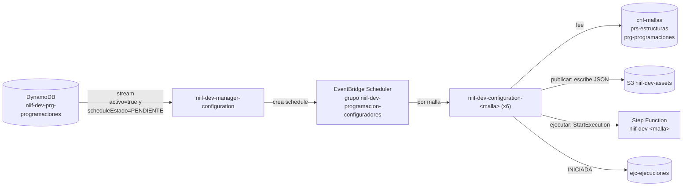

# Inventario de lambdas de trabajo (gestor de configuración NIIF 17)

**Fuente:** extracción por script (datos crudos en `extraccion\` de esta carpeta; código y configuración de cada lambda en su carpeta `Backend\Lamnbdas\<lambda>\`), cuenta `533267035849`, `us-east-1`, DEV. Corte: 2026-11-03. No hay repositorio Git: **el código desplegado es la única fuente**.
**Alcance (decidido 2026-11-03):** solo las **7 lambdas de trabajo** de la tabla 2. Las otras 55 de la cuenta se tratan como **pruebas / fuera de alcance** y se movieron a `Backend\Lamnbdas\pruebas-lambda\` (sección 6).
**Flujo de orquestación de estas lambdas:** `step-functions-niif.md` en esta carpeta.

> Lo marcado como **(inferido)** sale de leer el código y la configuración, sin ver ejecuciones reales.

---

## 1. Objetivo: consolidar los configuradores en una sola lambda general

Las 6 lambdas `niif-dev-configuration-<malla>` son **la misma lambda copiada**. Lo único que cambia entre ellas es la configuración por variables de entorno (tabla 3). Se propone **una sola lambda general estandarizada**, que reciba la malla como parámetro y lea lo específico de `niif-dev-cnf-mallas`. Detalle en la sección 5.

---

## 2. Lambdas de trabajo

| # | Lambda | Rol | Archivo / handler | Última modificación | Código local (referencia = copia de la `configurador` anterior, no es el desplegado) |
|---|---|---|---|---|---|
| 1 | `niif-dev-manager-configuration` | **Programador.** Escucha el stream de `niif-dev-prg-programaciones` y crea el *schedule* de cada malla. | `scheduler_configurators.lambda_handler` | 2026-10-09 | **No** (zip no descomprimido). **Sin referencia** |
| 2 | `niif-dev-configuration-auxilios-funerarios` | Configurador de la malla Auxilios Funerarios | `conf_auxilios.lambda_handler` (901 líneas) | 2026-10-20 | Sí |
| 3 | `niif-dev-configuration-primas-arl` | Configurador de Primas ARL | `conf_arl.lambda_handler` | 2026-10-20 | **Parcial**: solo librerías. Falta `conf_arl.py`; hay **referencia** (`configurador`) |
| 4 | `niif-dev-configuration-primas-rentas` | Configurador de Primas Rentas | `conf_rentas.lambda_handler` | 2026-10-20 | **No**; hay **referencia** (`configurador`) |
| 5 | `niif-dev-configuration-primas-endosos` | Configurador de Primas Endosos | (sin dato) | (sin dato) | **No** y sin configuración (archivo vacío); hay **referencia** (`configurador`) |
| 6 | `niif-dev-configuration-reserva-matematica-arp` | Configurador de Reserva Matemática ARP | `conf_res_mat_arp.lambda_handler` | 2026-10-22 | **Parcial**: solo `pytz`. Falta `conf_res_mat_arp.py`; hay **referencia** (`configurador`) |
| 7 | `niif-dev-configuration-reserva-matematica-rvi` | Configurador de Reserva Matemática RVI | (sin dato) | (sin dato) | **No** y sin configuración (archivo vacío); hay **referencia** (`configurador`) |

Todas: Python 3.12, 512 MB, timeout 300 s, paquete de ~45,6 MB, etiqueta `ManagedBy = Terraform-Terragrunt` (la única generación con IaC).

**Código de referencia (2026-11-03):** para las filas 3 a 7 se copió el `lambda_function.py` de la lambda anterior `niif-dev-configurador-<malla>` a `Backend\inventario\lambdas\codigo\referencia-configurador\`. Se comparó con auxilios (la única con código real): la `configuration` es la `configurador` más ~120 líneas (92,3 % igual), con dos funciones nuevas: `_evento_desde_prg` (lee `prg-programaciones`) y `_resolver_where_periodo` (fechas del periodo en los filtros). **No es el código desplegado**; sirve para avanzar con la lambda general. El manager no tiene equivalente local.

**Carpeta de trabajo (2026-11-03):** `Backend\Lamnbdas\<nombre-lambda>\` tiene una carpeta por lambda de esta tabla con su `.py`: el real en auxilios y la copia de la `configurador` en las filas 3 a 7 (cada una con `ORIGEN.md`). El manager solo tiene `PENDIENTE.md`. El inventario original sigue sin cambios en `Backend\inventario\`.

**Pendiente de extracción:** el log (`Backend\inventario\_errores.log`) muestra **disco lleno** en CloudShell al descomprimir. Hay que repetir la extracción de las filas 1 y 3 a 7 (la 2 está completa) con `cloudshell-inventario\inventario.sh niif-dev-configuration` y `niif-dev-manager` (el script ya borra lo pesado), o descargar cada zip con `aws lambda get-function --query Code.Location`.

### 2.1 Cómo se conectan



---

## 3. Fichas

### 3.1 `niif-dev-manager-configuration` (programador)
- **Disparador:** stream de `niif-dev-prg-programaciones`, lote de 10, ventana de 1 s, con **filtro** `activo = true` y `scheduleEstado = PENDIENTE`.
- **Qué hace (inferido, falta código):** valida la programación y crea o actualiza el *schedule* de la malla en el grupo `niif-dev-programacion-configuradores`, con la lambda destino tomada de `CONFIGURADORES_JSON`.
- **Variables:** `SCHEDULER_ROLE_ARN`, `ACCOUNT_ID`, `CONFIGURADORES_JSON`, `PRG_TABLE`, `SCHEDULE_GROUP`.
- **Hallazgo:** `CONFIGURADORES_JSON` apunta a las 6 lambdas. Se había dado por inexistentes `primas-endosos` y `reserva-matematica-rvi`: **sí existen en la cuenta** (aparecen en `list-functions`), pero su extracción salió vacía. Falta confirmar el código y que los *schedules* sí se creen para esas dos.

### 3.2 `niif-dev-configuration-<malla>` (configurador, x6)
Basado en `conf_auxilios.py` (única con código completo). Disparo por *schedule* o invocación manual con `publicar`, `ejecutar` y `periodoNegocio`.

1. Lee la configuración de la malla en `niif-dev-cnf-mallas` (`GENERAL`, `EXTRACCION`, `VALIDACION`, `REMEDIACION`, `SCD`, `CICLO#001` a `003`) y la estructura en `niif-dev-prs-estructuras`.
2. Lee la programación en `niif-dev-prg-programaciones` (`PRG_PK`, `PRG_SK`) para el periodo.
3. Arma los JSON de extracción, validación, remediación y SCD, y aplica el periodo.
4. Si `publicar`: persiste en DynamoDB con transacción y escribe los JSON en S3.
5. Si `ejecutar`: inicia la Step Function (`STATE_MACHINE_ARN`) y registra `INICIADA` en `niif-dev-ejc-ejecuciones`.

---

## 4. Lo que cambia entre las copias

Variables de entorno de las 4 configuraciones que sí se extrajeron. **Es lo único que las distingue:**

| Variable | Auxilios | Primas ARL | Primas Rentas | Reserva ARP |
|---|---|---|---|---|
| `MALLA_PK` | `MALLA#AUXILIOS_FUNERARIOS` | `MALLA#PRIMAS_ARL` | `MALLA#PRIMAS_RENTAS` | `MALLA#RESERVA_MATEMATICA_ARP` |
| `PRG_PK` | `PROGRAMACION#AUXILIOS_FUNERARIOS` | `PROGRAMACION#PRIMAS_ARL` | `PROGRAMACION#PRIMAS_RENTAS` | `PROGRAMACION#RESERVA_MATEMATICA_ARP` |
| `STATE_MACHINE_ARN` | `...:niif-dev-auxilios-funerarios` | `...:niif-dev-primas-arl` | `...:niif-dev-primas-rentas` | `...:niif-dev-reserva-matematica-arp` |

Iguales en todas: `CNF_TABLE = niif-dev-cnf-mallas`, `PRS_TABLE = niif-dev-prs-estructuras`, `EJC_TABLE = niif-dev-ejc-ejecuciones`, `PRG_TABLE = niif-dev-prg-programaciones`, `PRG_SK = METADATA`.

Las tres variables que cambian se pueden **derivar del nombre de la malla**. Por eso el código no necesita una copia por malla.

---

## 5. Propuesta: una lambda general estandarizada

**Propuesta. Validar con T2.** Ya hay un **spike** con esta estructura para Primas Rentas, con 37 pruebas que pasan: `spike-primas-rentas\` en esta carpeta (ver su `README.md`). No está desplegado ni probado contra AWS.

1. **Una sola lambda** `niif-dev-configuration` (o `configurador-malla`), que recibe `malla` (por ejemplo `AUXILIOS_FUNERARIOS`) en el evento del *schedule*. Deriva `MALLA_PK`, `PRG_PK` y la Step Function (`niif-dev-<malla-en-kebab>`) o las lee de `cnf-mallas`. Lo específico de cada malla vive en DynamoDB, no en el código.
2. **El programador** `niif-dev-manager-configuration` apunta todos los *schedules* a esa única lambda y la malla va en el `Input` del *schedule* (hoy usa `CONFIGURADORES_JSON`, con una lambda por malla).
3. **Estructura del proyecto**, con capas y pruebas:
   ```
   lambdas/configurador/
     src/configurador/
       handler.py         # 20-40 líneas: parsea evento, llama al servicio, responde
       servicio.py        # reglas de negocio puras (sin boto3)
       repositorios.py    # DynamoDB, S3 y Step Functions detrás de interfaces
       modelos.py         # contrato de entrada y salida
       config.py          # lee y valida variables; falla si falta alguna
     tests/
     pyproject.toml
   ```
4. **Paquete liviano:** hoy pesa 45 MB por numpy, pandas y dateutil que **no se importan**. Debe quedar en pocos MB.
5. **Un solo contrato de entrada** con la Step Function (ver `step-functions-niif.md`, SF-01) y logs JSON con `ejecucion_id`.
6. **Pruebas:** unitarias para el servicio; de integración contra LocalStack (`Backend\localstack\`; Scheduler no está incluido).
7. **Migración sin riesgo:** crear la general, probarla con una malla (auxilios, que tiene código completo), mover malla por malla y retirar las copias al final.

---

## 6. Qué quedó fuera (pruebas)

Se movieron **sin modificar** a `Backend\Lamnbdas\pruebas-lambda\{codigo,config}` (46 carpetas de código y 245 archivos de configuración). Las de la tabla 2 tienen su carpeta en `Backend\Lamnbdas\<lambda>\` (código y `config\` sin las URL prefirmadas).

| Grupo | Ejemplos |
|---|---|
| Programadores y configuradores de generaciones anteriores | `niif-dev-programador-configuraciones`, `niif-dev-configurador-<malla>` (x6), `niif-dev-configurador-extraccion`, `niif-dev-iniciador-ejecucion`, `niif-dev-finalizador-ejecucion`, `niif-dev-programador-cargues`, `niif-dev-programacion-cargues-target` |
| Certificación y notificación (paso 3) | `niif-dev-certification`, `niif-dev-composite-notification-evaluator`, `niif-dev-short-link-redirect`, `datalake-dev-niif-*`, `certification` |
| Pruebas | `test`, `test-lambda`, `testMapFunction`, `testNotifications`, `PRUEBA_JQ`, `Prueba_MC`, `Prueba_MC_1`, `CheckValidation` |
| Datalake de clientes y utilidades | `EnvioSftpFis`, `deleteModel`, `ReProcessLambda`, `rollback-bronce`, `lmb-read-params`, `files-struct-quality`, `alfaproject-dev-smbclient`, `postLogin` |
| Plataforma (CloudGuard, Control Tower, QuickSetup) | `CloudGuard*`, `aws-controltower-*`, `aws-quicksetup-*`, `ALFA-DEV-DATALAKE-PipelineObserver` |

**Nota:** `niif-dev-composite-notification-evaluator` (la única lambda que invoca la Step Function) y las del paso 3 quedaron fuera de este alcance por decisión de trabajo. Se siguen mencionando en `step-functions-niif.md` porque la Step Function las llama; si se necesitan en detalle, se recuperan de `pruebas-lambda\`.

---

## 7. Hallazgos de las lambdas de trabajo

El ID definitivo se asigna en la matriz de brechas (`Docs\06-brechas\`).

| ID | Categoría | Hallazgo | Evidencia |
|---|---|---|---|
| LMB-01 | Arquitectura | **Seis copias de la misma lambda**, con diferencias solo en 3 variables de entorno. Un arreglo hay que hacerlo 6 veces. | Sección 4 |
| LMB-02 | Arquitectura | `manager-configuration` y `programador-configuraciones` (fuera de alcance) **escuchan el mismo stream**. Si ambos siguen activos, cada programación crea *schedules* duplicados. Confirmar en EventBridge Scheduler. | `config\niif-dev-manager-configuration.triggers.json` |
| LMB-03 | Arquitectura | El stream del manager tiene **reintentos infinitos y sin destino de fallo**: un registro defectuoso bloquea el *shard* hasta 24 h y se pierde sin aviso. | Mismo archivo |
| LMB-04 | Calidad | Handler de 170 a 250 líneas, un solo archivo de ~900 líneas, **sin pruebas**; no cumple la cobertura > 80 % del lineamiento de código seguro. | `conf_auxilios.py` |
| LMB-05 | Calidad | Paquete de 45 MB con numpy y pandas que **no se importan**: arranque en frío más lento y más superficie de vulnerabilidades. | `CodeSize`, `codigo\...\numpy` |
| LMB-06 | Calidad | Imports repetidos dentro del handler, código muerto (`comparaciones = []`, `"estructurasPRSValidadas": 4` fijo). | `conf_auxilios.py` |
| LMB-07 | Cumplimiento | Logs en formato texto, sin `ejecucion_id` común (exigido por HU-GI-07). Sin DLQ ni *destinations*. | `LoggingConfig`, `DeadLetterConfig` |
| LMB-08 | Seguridad | `config\*.json` guardan `Code.Location`: URL prefirmada con token de sesión. No versionar. | Archivos de `config\` |
| LMB-09 | Arquitectura | **Inventario incompleto:** faltan el código del manager y de 4 de los 6 configuradores, y la configuración de endosos y RVI. | Sección 2 |
