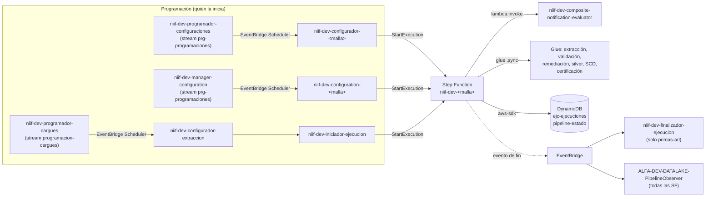
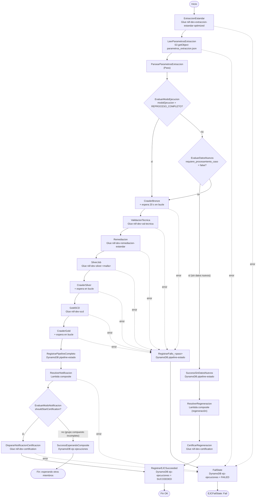
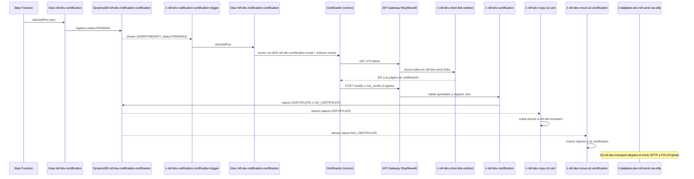

# Step Functions NIIF 17: flujo, qué llama cada paso y qué hace

**Fuente:** inventario extraído por script en `Backend\StepFunctions\` (definiciones ASL) y `Backend\Eventos\` (reglas de EventBridge), cuenta `533267035849`, `us-east-1`, ambiente DEV. Corte del inventario: 2026-11-03.
**Alcance (decidido 2026-11-03):** las **6 máquinas de trabajo `niif-dev-<malla>`**, las de las 6 mallas que configuran las lambdas de `lambdas.md`. Las otras 67 definiciones se movieron **sin modificar** a `Backend\StepFunctions\pruebas-stepfunctions\` y se listan al final (sección 8).
**Inventario de lambdas de trabajo:** ver `lambdas.md` en esta misma carpeta.

> Lo marcado como **(inferido)** sale de leer el código y la configuración, no de una ejecución real. Debe confirmarse con el historial de ejecuciones en la consola cuando haya acceso.

---

## 1. Resumen en una página

- En la cuenta hay **73 Step Functions**. **6 son de trabajo** (`niif-dev-<malla>`); las otras 67 son pruebas, versiones anteriores, datalake de clientes o calidad, y quedaron en `pruebas-stepfunctions\`.
- El flujo de trabajo es **`niif-dev-<malla>`**: una máquina de **40 estados** por caso de uso (6 copias casi idénticas), iniciada por `niif-dev-configuration-<malla>`. Cubre el **paso 2** del diagrama TOBE, desde la extracción hasta Gold, y **dispara el paso 3** (certificación).
- La Step Function **solo llama a una lambda**: `niif-dev-composite-notification-evaluator`. Todo lo demás son **jobs y crawlers de Glue** y escrituras directas a **DynamoDB y S3** (integraciones `aws-sdk`).
- **Riesgo principal:** además de las lambdas de trabajo, hay **otras lambdas (fuera de alcance, en `pruebas-lambda\`) que pueden iniciar la misma Step Function con un contrato de entrada distinto**, y dos programadores escuchando la misma tabla. Ver la sección 7.

---

## 2. Inventario: de trabajo y pruebas

### 2.1 De trabajo (6)

Se inician con `niif-dev-configuration-<malla>` (variable `STATE_MACHINE_ARN`).

| Step Function | Estados | Creada | Lambda que la inicia | Qué hace |
|---|---|---|---|---|
| `niif-dev-primas-arl` | 40 | 2026-09-11 | `niif-dev-configuration-primas-arl` | Pipeline completo + certificación. Plantilla de referencia de este documento. |
| `niif-dev-primas-endosos` | 40 | 2026-09-11 | `niif-dev-configuration-primas-endosos` | Copia de la plantilla. |
| `niif-dev-primas-rentas` | 40 | 2026-09-11 | `niif-dev-configuration-primas-rentas` | Copia de la plantilla. |
| `niif-dev-auxilios-funerarios` | 40 | 2026-09-11 | `niif-dev-configuration-auxilios-funerarios` | Copia; el job Silver recibe `fecDesde`/`fecHasta` en lugar de `PER_CORTE`. |
| `niif-dev-reserva-matematica-arp` | 40 | 2026-09-11 | `niif-dev-configuration-reserva-matematica-arp` | Copia; la remediación recibe además `RUTA_CONFIG_REMEDIACION`. |
| `niif-dev-reserva-matematica-rvi` | 40 | 2026-09-11 | `niif-dev-configuration-reserva-matematica-rvi` | Igual que ARP. |

### 2.2 Pruebas / fuera de alcance (67)

Movidas a `Backend\StepFunctions\pruebas-stepfunctions\`. Resumen:

| Grupo | Máquinas | Nota |
|---|---|---|
| Variantes NIIF | `niif-dev-primas-previsional` (34), `niif-dev-gestor-archivos` (27), `niif-dev-campos-unica-vez` (27, duplicado), `niif-dev-primas-arl-continuacion-019` (36) | Sección 5. |
| v1 `orquestador-niif17-<malla>` (6) y `-pruebas` (3) | 13 y 9 estados | Anteriores; sección 5.4. |
| Pruebas personales | `PASO1_PRUEBAS_PRIMASARL`, `PASO2_PRUEBAS_PRIMASARL`, `PRIMASARL_ORQUESTADOR_ETL_MANUEL_MACHADO` | Candidatas a eliminar. |

**Configuración común de las 6 de trabajo:** tipo `STANDARD`, **logs desactivados** (`loggingConfiguration.level = OFF`), X-Ray activo y una sola región.

---

## 3. Flujo de `niif-dev-<malla>` paso a paso

Plantilla: `niif-dev-primas-arl`. Las otras cinco copias cambian rutas, nombres de job y las diferencias de la sección 6.

### 3.1 Diagrama

### 3.2 Tabla de pasos

"Llama a" indica el servicio y recurso que invoca el estado. "Si falla" indica a qué estado salta el `Catch`.

| # | Estado | Tipo | Llama a | Qué hace | Si falla |
|---|---|---|---|---|---|
| 1 | `ExtraccionEstandar` | Task `.sync` | Glue `niif-dev-extraccion-estandar-optimized` | Extrae de la fuente a Bronze con `RUTA_CONFIG_EXTRACCION = s3://niif-dev-assets/<malla>/config_extraccion_<malla>.json` (ruta **fija**). Espera a que termine el job. Reintenta 2 veces ante `States.ALL`. | `FailState` |
| 2 | `LeerParametrosExtraccion` | Task | S3 `GetObject` `niif-dev-assets/<malla>/parametros_extraccion.json` | Lee el archivo que dejó el job de extracción: periodo de negocio, lote, nombre del caso y si hay datos nuevos. | `FailState` |
| 3 | `ParsearParametrosExtraccion` | Pass | — | Convierte el texto a JSON en `$.parametros_extraccion.parametros`. | — |
| 4 | `EvaluarModoEjecucion` | Choice | — | Si la entrada trae `modoEjecucion = REPROCESO_COMPLETO`, salta directo al crawler Bronze. | — |
| 5 | `EvaluarDatosNuevos` | Choice | — | Si `requiere_procesamiento_caso = false`, no hay llaves nuevas: rama de **regeneración** (pasos 6 a 8). Si no, sigue el pipeline. | — |
| 6 | `SuccessSinDatosNuevos` | Task | DynamoDB `UpdateItem` `niif-dev-pipeline-estado` | Registra `SUCCESS_SIN_DATOS_NUEVOS`, con llave `dev#<caso>#<periodo>`. | `FailState` |
| 7 | `ResolverRegeneracion` | Task | **Lambda `niif-dev-composite-notification-evaluator`** (`mode = RESOLVE_NOTIFICATION`, `regeneracionSinDatosNuevos = true`) | Resuelve qué configuración de notificación usar; si el caso pertenece a un grupo compuesto, usa la del grupo. | `FailState` |
| 8 | `CertificarRegeneracion` | Task `.sync` | Glue `niif-dev-certification` | Regenera el correo de certificación con los datos Gold ya existentes del periodo. | `FailState` |
| 9 | `CrawlerBronze` | Task | Glue `StartCrawler` `niif-dev-crawler-bronze` | Actualiza el catálogo Bronze. Si el crawler ya está corriendo (`CrawlerRunningException`), solo espera. | `RegistrarFallo_CrawlerBronze` |
| 10 | `EsperarCrawlerBronze` → `ConsultarCrawlerBronze` → `EvaluarCrawlerBronze` | Wait 20 s + Task + Choice | Glue `GetCrawler` | Bucle de sondeo cada 20 s hasta `SUCCEEDED`, `FAILED` o `CANCELLED`. **No tiene límite de vueltas.** | `RegistrarFallo_CrawlerBronze` |
| 11 | `ValidacionTecnica` | Task `.sync` | Glue `niif-dev-val-tecnica` | Validación técnica de Bronze (`config_val_tec_<malla>.json`). | `RegistrarFallo_ValidacionTecnica` |
| 12 | `Remediacion` | Task `.sync` | Glue `niif-dev-remediacion-estandar` | Aplica la remediación sobre lo validado y lo deja en `silver/niif/remediacion/<malla>/`. | `RegistrarFallo_Remediacion` |
| 13 | `SilverJob` | Task `.sync` | Glue `niif-dev-silver-<malla>` | Prepara Silver con `PER_CORTE` (periodo de negocio). Rutas `silver_preparado_*` y `tmp_preparacion_*`. | `RegistrarFallo_SilverJob` |
| 14 | `CrawlerSilver` + bucle | Task + Wait + Choice | Glue `niif-dev-crawler-silver` | Igual que el paso 10, sobre Silver. | `RegistrarFallo_CrawlerSilver` |
| 15 | `GoldSCD` | Task `.sync` | Glue `niif-dev-scd` | Carga Gold con historia SCD (`config_scd_<malla>.json`). | `RegistrarFallo_GoldSCD` |
| 16 | `CrawlerGold` + bucle | Task + Wait + Choice | Glue `niif-dev-crawler-gold` | Igual que el paso 10, sobre Gold. | `RegistrarFallo_CrawlerGold` |
| 17 | `RegistrarPipelineCompleto` | Task | DynamoDB `UpdateItem` `niif-dev-pipeline-estado` | Registra `PIPELINE_COMPLETO` y `ultimo_paso_exitoso = CrawlerGold`. **Si falla, sigue igual** (el `Catch` apunta al siguiente paso). | `ResolverNotificacion` |
| 18 | `ResolverNotificacion` | Task | **Lambda `niif-dev-composite-notification-evaluator`** (`mode = RESOLVE_NOTIFICATION`) | Decide si se notifica ya o se espera: **SIMPLE** (caso suelto, notifica), **COMPOSITE_WAITING** (faltan miembros del grupo), **COMPOSITE_READY** (el último miembro listo toma un *lock* en DynamoDB y notifica por todo el grupo). Ver `lambdas.md`. | `FailState` |
| 19 | `EvaluarModoNotificacion` | Choice | — | `shouldStartCertification = true` → certificar; si no → terminar esperando al grupo. | — |
| 20 | `DispararNotificacionCertificacion` | Task `.sync` | Glue `niif-dev-certification` | Calcula las cifras de control y registra la certificación como `PENDING` en `niif-dev-notification-certification` **(inferido)**. Desde ahí arranca la cadena de la sección 4. | `FailState` |
| 21 | `RegistrarEJCSucceeded` | Task | DynamoDB `UpdateItem` `niif-dev-ejc-ejecuciones` (`PK = $.ejcPK`, `SK = $.ejcSK`) | Marca la ejecución `SUCCEEDED` con fecha de fin. Fin. | — |
| 22 | `SuccessEsperandoComposite` → `EJCFinEsperandoComposite` | Task + Succeed | DynamoDB `niif-dev-ejc-ejecuciones` | Marca la ejecución como exitosa en espera del grupo compuesto. Fin. | — |
| 23 | `RegistrarFallo_<paso>` (×7) | Task | DynamoDB `UpdateItem` `niif-dev-pipeline-estado` | Guarda `FAILED`, el paso fallido, el error y `reanudar_desde = <paso>`. | `FailState` |
| 24 | `FailState` | Task | DynamoDB `UpdateItem` `niif-dev-ejc-ejecuciones` | Marca la ejecución `FAILED`. | — |
| 25 | `EJCFailState` | Fail | — | Termina con error `NIIF17PipelineFailed`. | — |

### 3.3 Contrato de entrada esperado

La máquina lee de la entrada **solo** estos campos:

| Campo | Uso | Si falta |
|---|---|---|
| `ejcPK`, `ejcSK` | Llave del registro en `niif-dev-ejc-ejecuciones` (pasos 21, 22 y 24). | El paso falla con `States.Runtime`. En `FailState` no hay `Catch`, así que la ejecución termina sin dejar rastro en DynamoDB. |
| `modoEjecucion` | `REPROCESO_COMPLETO` salta la decisión de datos nuevos. | Opcional. |
| `fecDesde`, `fecHasta` | Solo en `auxilios-funerarios` (job Silver). | `States.Runtime` en `SilverJob`. |

`rutaConfigExtraccion`, `periodoNegocio`, `malla` y `origen` **se reciben pero no se usan**: la máquina trabaja con rutas S3 fijas y toma el periodo de `parametros_extraccion.json`.

### 3.4 Tablas y archivos que toca

| Recurso | Operación | Pasos |
|---|---|---|
| `niif-dev-ejc-ejecuciones` (DynamoDB) | `UpdateItem` estado final | 21, 22, 24 |
| `niif-dev-pipeline-estado` (DynamoDB) | `UpdateItem` estado del pipeline por `ambiente#caso#periodo` | 6, 17, 23 |
| `niif-dev-composite-notification-status` (DynamoDB) | Escrito por la lambda composite (miembros y *lock*) | 7, 18 |
| `s3://niif-dev-assets/<malla>/...` | Lectura de configuración y parámetros | 1, 2, 11, 12, 13, 15 |
| `s3://alfa-datalake-dev-silver/niif/...` | Escritura vía Glue | 12, 13 |

---

## 4. Después de la Step Function: cadena de certificación (paso 3)

La Step Function termina al disparar el job de certificación. El resto ocurre **por eventos**, fuera de la máquina de estados **(inferido de los disparadores)**:

**Consecuencia de diseño:** la ejecución de la Step Function queda `SUCCEEDED` aunque nadie certifique, el correo falle o el transporte nunca ocurra. **No existe un estado único que diga "el periodo quedó certificado y transportado".** Coincide con los riesgos 3, 4 y 11 de `Tareas\riesgos-flujo-glue-notificacion.md` y con la propuesta de `waitForTaskToken`.

---

## 5. Variantes (fuera de alcance, en `pruebas-stepfunctions\`)

Se conservan como referencia: no son de trabajo.

### 5.1 `niif-dev-primas-previsional` (34 estados)
- `ValidarEntrada` (Pass) → `PrepararFechaCarga` → `GenerarLoteCargue`: un **contador atómico** en DynamoDB (`counter#primas_previsional`, `ADD ultimo_lote 1`) genera el `lote_cargue_id`.
- `EjecutarGestorJSON` (Glue `niif-dev-gestor-archivos`) → `ValidarSalidaOUT` (S3 `HeadObject`) → `LeerMetadataEjecucion` → `IniciarCrawlerBronze` y su bucle → `EjecutarGoldPrevisional` (Glue `niif-dev-gold-scd`) → crawler Gold y su bucle → `RegistrarPipelineCompleto`.
- `EvaluarNotificar` → `ResolverNotificacion` (**lambda composite**) → `EjecutarCertificacion` (Glue `niif-dev-certification`).
- **Problema:** `ValidarEntrada` es un `Pass` con `Parameters: {"notificar": true}`. Eso **reemplaza toda la entrada**: cualquier valor que llegue (incluido `notificar = false`) se pierde y siempre se notifica.

### 5.2 `niif-dev-gestor-archivos` y `niif-dev-campos-unica-vez` (27 estados)
- Contador de lote → Glue `niif-dev-gestor-archivos` → `HeadObject` de la salida → crawler `niif-dev-crawler-previsional-bronze` → Glue `niif-dev-gold-scd` → crawler `niif-dev-crawler-previsional-gold` → crawler `niif-dev-crawler-logs-validation` → registro en DynamoDB.
- Todo fallo pasa por `PrepararFallo*` → `IniciarCrawlerLogs` → `RegistrarFalloPipeline` → `FailState`.
- Las dos máquinas tienen los mismos estados; el comentario de `gestor-archivos` dice "Campos Única Vez". **Son duplicados.**

### 5.3 `niif-dev-primas-arl-continuacion-019`
- Empieza en `InicioContinuacion`: si `__iniciarDesdeExtraccion = true` va a `ExtraccionEstandar`; si no, arranca en `CrawlerSilver`.
- Es una copia manual para reanudar una ejecución. La tabla `pipeline-estado` ya guarda `reanudar_desde`, pero ninguna máquina lo usa para reanudar de forma genérica.

### 5.4 `orquestador-niif17-<malla>` (v1, 13 estados)
Lineal: extracción → parámetros → ¿datos nuevos? → crawler Bronze → validación → remediación → Silver → crawler → SCD → crawler Gold. Usa los jobs `datalake-dev-niif-*`.
- Cada crawler se lanza con `StartCrawler` y la máquina sigue **sin esperar a que termine**, así que el job siguiente puede leer un catálogo desactualizado.
- No registra trazabilidad ni dispara certificación.
- **(inferido)** Reemplazada por `niif-dev-<malla>`; confirmar si sigue en uso antes de borrarla.

---

## 6. Diferencias entre las 6 copias (*drift*)

Se compararon normalizando el nombre del caso. Todas deberían ser idénticas; no lo son.

| Diferencia | Dónde | Efecto |
|---|---|---|
| `Cause` del `Fail` dice "Reserva Matematica ARP" | `primas-arl` | Un fallo de Primas ARL se reporta con el nombre de otra malla. |
| Mensaje del crawler fallido: texto fijo vs. `States.JsonToString($.error_crawler_*)` | `primas-arl` vs. el resto | En `primas-arl` se pierde el error real del crawler. |
| `ResultPath` del `Catch` de `CrawlerGold`: `$.error_registro_estado_pipeline` vs. `$.error_crawler_gold` | `primas-arl` vs. el resto | Rutas de error inconsistentes para el monitoreo. |
| `configKey` de notificación: `primasRentasEndosos.json`, `reservaMatematicaRviArp.json`, etc. | endosos, rentas, ARP, RVI | Rentas y Endosos comparten configuración, y ARP y RVI también: son **grupos compuestos**. |
| `useCaseId = auxilioFunerario` (singular) vs. carpeta `auxilios-funerarios` | auxilios | Nombres de caso de uso sin convención. |
| `--S3_TMP_PREP_PATH` y `--PER_CORTE` solo en `primas-arl` | Silver | Cada job Silver recibe parámetros distintos. |
| `RUTA_CONFIG_REMEDIACION` solo en ARP y RVI | Remediación | Ídem. |
| Tildes en textos (`automáticamente` vs. `automaticamente`) | todas | Indicio de edición manual por copia. |

**Conclusión:** las 6 máquinas deberían ser **una sola plantilla parametrizada**: una definición en Terraform con `templatefile` o una única máquina que reciba la malla en la entrada.

---

## 7. Hallazgos

Las categorías siguen el estándar de brechas. El ID se consolidará en la matriz de la fase 3 (`Docs\06-brechas\`).

| ID | Categoría | Hallazgo | Evidencia | Propuesta |
|---|---|---|---|---|
| SF-01 | Arquitectura | **Tres iniciadores con contratos incompatibles.** `configuration-<malla>` (de trabajo) envía `ejcPK`/`ejcSK`; `configurador-<malla>` repite el mismo contrato; `iniciador-ejecucion` (G2, en `pruebas-lambda\`) envía `idAutomatizacion`, `rutaConfig*` y no envía `ejcPK`/`ejcSK`. Una ejecución lanzada por el iniciador falla al registrar su estado. | `iniciador-ejecucion/lambda_function.py:338`, `configurador-primas-arl/lambda_function.py:545`, estado `FailState` | Un único contrato de entrada versionado y un único iniciador. |
| SF-02 | Arquitectura | **Dos programadores sobre la misma tabla.** `niif-dev-manager-configuration` (de trabajo, con filtro) y `niif-dev-programador-configuraciones` (lote 1, sin filtro, en `pruebas-lambda\`) leen el stream de `niif-dev-prg-programaciones`. Cada uno crea *schedules* hacia lambdas distintas (`configuration-*` y `configurador-*`), y ambas inician la misma Step Function. Riesgo de **doble ejecución** del pipeline. | `lambdas\config\niif-dev-manager-configuration.triggers.json`, `lambdas\pruebas-lambda\config\` | Desactivar el programador de la generación anterior y confirmar en EventBridge Scheduler qué *schedules* existen. |
| SF-03 | Arquitectura | **Corregido el 2026-11-03.** Se había afirmado que `niif-dev-configuration-primas-endosos` y `niif-dev-configuration-reserva-matematica-rvi` no existían. **Sí existen** en la cuenta (`list-functions`); su extracción salió vacía por el disco lleno. Falta traer su código y confirmar que el manager crea sus *schedules*. | `lambdas\nombres_todas.txt`; `lambdas.md` sección 2 | Repetir la extracción de esas dos. |
| SF-04 | Arquitectura | `niif-dev-finalizador-ejecucion` (G2, en `pruebas-lambda\`) solo escucha `primas-arl` y espera los campos del iniciador (`idAutomatizacion`, `idLoteCargue`). Con ejecuciones lanzadas por el configurador falla con `KeyError`. Además, la máquina ya actualiza `ejc-ejecuciones`: **doble registro de estado**. | Regla `niif-dev-finalizar-ejecucion-primas-arl`, `finalizador/lambda_function.py:238` | Un solo dueño del estado de la ejecución. |
| SF-05 | Arquitectura | **Rutas S3 fijas compartidas entre ejecuciones:** `parametros_extraccion.json` y `config_*.json` no incluyen periodo ni ID de ejecución. Dos ejecuciones simultáneas (o un reproceso) se pisan los parámetros. | Estados `ExtraccionEstandar` y `LeerParametrosExtraccion` | Ruta por ejecución (`.../periodo=
/<execution-id>/`), como ya hace `configurador-extraccion`. |
| SF-06 | Arquitectura | Bucles de sondeo de crawlers **sin tope de vueltas** (Wait 20 s). Un crawler colgado deja la ejecución viva hasta el límite de un año de las ejecuciones STANDARD. | `EvaluarCrawler*` | Contador de vueltas o `TimeoutSeconds` en la máquina. |
| SF-07 | Arquitectura | `FailState` es un `UpdateItem` **sin `Catch`**: si falla (por ejemplo, porque falta `ejcPK`), el error original se pierde. | Estado `FailState` | `Catch` hacia un `Fail` directo con la causa original. |
| SF-08 | Arquitectura | `RegistrarPipelineCompleto` captura su propio error y sigue: el pipeline puede notificar sin haber registrado el estado. | `Catch` → `ResolverNotificacion` | Fallar o reintentar. |
| SF-09 | Arquitectura | La Step Function termina antes de certificar y transportar; no hay estado de punta a punta (sección 4). | Diseño | `waitForTaskToken` (propuesta en `Tareas\riesgos-flujo-glue-notificacion.md`). |
| SF-10 | Seguridad / cumplimiento | **Logs de ejecución desactivados** en las 73 máquinas. Sin historial más allá de 90 días ni evidencia para auditoría (el marco normativo exige 7 años de retención de evidencia). | `loggingConfiguration.level = OFF` | Nivel `ERROR` como mínimo, con `includeExecutionData = false` para no registrar datos. |
| SF-11 | Calidad | 6 copias con *drift* (sección 6), duplicados (`gestor-archivos` / `campos-unica-vez`), copia manual de reanudación y 9 máquinas de prueba en DEV. Las 67 que no son de trabajo ya están apartadas en `pruebas-stepfunctions\`. | Inventario | Plantilla única en Terraform; limpieza de las máquinas de prueba. |
| SF-12 | Calidad | `ValidarEntrada` de `primas-previsional` sobrescribe toda la entrada con `{"notificar": true}`. | Sección 5.1 | Usar `ResultPath` o `Assign`. |
| SF-13 | Costos | `ALFA-DEV-DATALAKE-PipelineObserver` lee el **historial completo** (hasta 10 000 eventos) de **cada** ejecución que termina en la cuenta, incluidas las de prueba. Con bucles de sondeo cada 20 s, el historial crece mucho. | `PipelineObserver/index.py:24` | Filtrar la regla a las máquinas NIIF y reducir los eventos de sondeo. |
| SF-14 | Arquitectura (positivo) | Ya existe un **plano técnico de observabilidad**: el observer publica métricas EMF (`ALFA/DATALAKE`) y avisa por SNS `ALFA-DEV-DATALAKE-Critical`/`Warning` cuando falla una SF. Es la base de la tarea 1c. | `PipelineObserver/index.py:60` | Reutilizarlo en la propuesta de observabilidad (`Tareas\T1-notificaciones\propuesta-observabilidad-eventos.md`). |

---

## 8. Resto del inventario (fuera de alcance)

Está en `Backend\StepFunctions\pruebas-stepfunctions\`. Sin detalle.

| Grupo | Máquinas | Nota |
|---|---|---|
| Variantes y v1 de NIIF | Ver sección 2.2 | |
| Datalake clientes (Bronze/Silver/Gold, MVP2) | `datalake-dev-clientes-*`, `sf-flow-clients-*`, `sf-alfaprd-*`, `alfaprd-silver-periods-*` | Usan `datalake-dev-clientes-smb*` (lambdas en imagen de contenedor). |
| Calidad | `calidad-*`, `datalake-dev-calidad-*`, `CalidadStateMachine` | Varias versiones del mismo flujo. |
| Datalake genérico v0 | `AlfaStepFunction*`, `datalake-dev-{bronce,silver,gold}[-change]-sf`, `GoldStepMachine`, `registrosCambiados`, `STF-test-SIPREN` | 2024–2025. |
| SMB / FileServer | `datalake-dev-smb-client-sf`, `FSStepFunction`, `smb-config-params-sf-bronze-clients`, `peps_sp`, `pruenbapm` | |
| Pruebas | `prueba`, `PRUEBA_JQ`, `Prueba_MC`, `job_test`, `test-invoke-lambdas`, `test_dynamo_orch`, `test_orch_bronce_jl[-copy]`, `datalake-dev-clientes-bronze-sf-copy_jqpm` | Candidatas a eliminar. |
