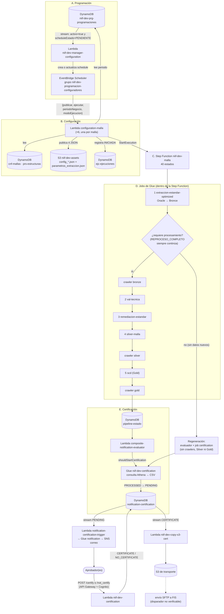

# Flujo integral del proceso NIIF 17 (pasos 2 y 3), de punta a punta

**Fuente:** el código y la configuración desplegados en la cuenta `533267035849` (us-east-1, DEV), extraídos el 2026-11-03: los 12 jobs de Glue (`Backend\Glue\`: 11 del pipeline y el de notificación), las 6 Step Functions (`Backend\StepFunctions\`), las lambdas (`Backend\Lamnbdas\`, incluida `pruebas-lambda\`), los triggers de DynamoDB y las reglas de EventBridge (`Backend\Eventos\`). **Revisado contra ese código el 2026-11-03.** No se vieron ejecuciones reales ni los JSON de configuración que viven en S3. Lo marcado **(inferido)** sale de leer código de una versión anterior o de la configuración, no del código desplegado.

**Qué tan sólida es la evidencia:**

| Pieza | Evidencia disponible |
|---|---|
| Step Functions, jobs de Glue, reglas de EventBridge, SNS | Definición y código desplegados (completos) |
| `niif-dev-configuration-auxilios-funerarios` | Código desplegado completo |
| Los otros 5 configuradores (`configuration-<malla>`) | **Solo copias** de la lambda anterior `configurador-<malla>`; no es el código desplegado (ver `ORIGEN.md` de cada carpeta). Esta guía los describe con Auxilios |
| `niif-dev-manager-configuration` | **Sin código** (solo configuración, ver `PENDIENTE.md`). Su comportamiento se infiere del programador anterior |
| `notification-certification-trigger`, `copy-s3-cert`, `move-s3-certification`, envío SFTP | **Sin código**, solo configuración |
| Notificaciones de los buckets S3 | Archivos de 0 bytes: no se puede ver qué evento dispara qué |

**Alcance:** las 6 mallas (Primas Rentas, Primas Endosos, Primas ARL, Auxilios Funerarios, Reserva Matemática ARP y RVI). Reemplaza el resumen disperso de `lambdas.md` y `step-functions-niif.md`, que siguen siendo el detalle por componente.

---

## 1. El proceso en una página

Una **programación** (fila en DynamoDB) dispara la creación de un *schedule*; cuando llega la hora, un **configurador** valida la configuración de la malla, publica sus parámetros en S3 y arranca una **Step Function**. La Step Function encadena jobs de Glue (extraer → validar → remediar → preparar Silver → consolidar Gold), decide si hay datos nuevos, registra el estado en DynamoDB y, al final, lanza el job de **certificación**, que genera los reportes y abre la cadena de aprobación y transporte. Los jobs **no se pasan datos entre sí**: se pasan un archivo de estado en S3 (`parametros_extraccion.json`).

---

## 2. Paso a paso

### A. Programación
1. Alguien (hoy se hace a mano; **no se encontró una pantalla o API**, por confirmar) escribe en `niif-dev-prg-programaciones` una fila `PK = PROGRAMACION#<MALLA>`, `SK = METADATA`, con `activo`, `scheduleExpression` (cron o `at(...)`), `scheduleName`, `scheduleTimezone`, `periodoNegocio`, `modoEjecucion` (opcional, por defecto `NORMAL`), `scheduleState` (opcional) y `scheduleEstado = PENDIENTE`. **(inferido)**: los campos salen del programador anterior; no hay código del manager.
2. El **stream** de la tabla, con filtro `activo = true` y `scheduleEstado = PENDIENTE`, invoca `niif-dev-manager-configuration` (lote de 10, ventana de 1 s, **2 reintentos**, división del lote en error, **sin destino de fallo**: un registro que falla 3 veces se pierde sin aviso). Confirmado en `niif-dev-manager-configuration.triggers.json`.
3. **(inferido)** El manager lee la fila, crea o actualiza el schedule en EventBridge Scheduler (grupo `niif-dev-programacion-configuradores`) con destino la lambda configuradora de esa malla, y marca `scheduleEstado = PROGRAMADO`. Si la fila no trae `scheduleState`, el schedule queda **`DISABLED`**. Si la expresión es `at(...)`, el schedule se borra solo al ejecutarse. El mapeo malla → lambda viene de la variable `CONFIGURADORES_JSON` (confirmada: apunta a las 6 lambdas) y el rol es `niif-dev-scheduler-configuradores-role`.
4. **(inferido)** Cuando llega la hora, el Scheduler invoca al configurador con `{"publicar": true, "ejecutar": true, "periodoNegocio": "...", "modoEjecucion": "NORMAL", "origen": "PROGRAMACION_GESTOR"}`, hasta 2 reintentos y 3 600 s de edad máxima del evento.

> **Ojo:** la misma tabla tiene un segundo mapeo **habilitado** hacia la lambda anterior `niif-dev-programador-configuraciones`, sin filtro y con reintentos infinitos (`pruebas-lambda\config\niif-dev-programador-configuraciones.triggers.json`). Si esa lambda sigue creando schedules, cada programación se duplica (LMB-02).

### B. Configuración (lambda `niif-dev-configuration-<malla>`)
Descrito con el código desplegado de Auxilios Funerarios (`conf_auxilios.py`).

> **Relación con la tarea T2 (lambda general estandarizada).** Estas son las 6 lambdas que T2 consolida en **una sola**: `niif-dev-configuration-primas-rentas`, `-primas-endosos`, `-primas-arl`, `-auxilios-funerarios`, `-reserva-matematica-rvi` y `-reserva-matematica-arp`. `niif-dev-manager-configuration` no se consolida con ellas: sigue siendo el programador y pasaría a apuntar todos los schedules a la lambda general, con la malla en el `Input`.
>
> **Lo que hay que quitar del código para unificarlas.** El inventario dice que las copias solo difieren en 3 variables de entorno (`MALLA_PK`, `PRG_PK`, `STATE_MACHINE_ARN`). Al comparar el código, además tienen **valores quemados por malla**:
> - el nombre de la malla en los metadatos de S3 y en el registro `INICIADA` (`PRIMAS_ARL`, `AUXILIOS_FUNERARIOS`, ...), y la clave `EJC#<MALLA>#`;
> - el prefijo del nombre de la ejecución (`arl-`, `auxilios-`);
> - el nombre del caso que valida la plantilla de remediación (`primas_arl`, `auxilios_funerarios`, ...);
> - el **número fijo de registros y ciclos** que debe tener `cnf-mallas`: 8 y 3 en Auxilios (código desplegado), y en las copias de la versión anterior 8 y 3 en ARL, 9 y 4 en Rentas y RVI, 7 y 2 en Endosos. Una malla con más o menos ciclos falla aunque su configuración sea válida;
> - Auxilios calcula `fecDesde` y `fecHasta` para la Step Function; las demás no;
> - en las copias de ARP y RVI, `where` y `dependencia` se arman solo si existen.
>
> La lambda general debe derivar todo eso de la malla recibida y de lo que haya en `cnf-mallas`, no de constantes.

5. Lee los registros de la malla en `cnf-mallas` (`PK = MALLA#<MALLA>`): exige exactamente `GENERAL`, `EXTRACCION`, `VALIDACION`, `REMEDIACION`, `SCD` y `CICLO#001` a `CICLO#003` (8 registros); si falta uno, falla. Cada uno trae la ruta S3 de su archivo activo (`archivoActivoUri`).
6. Lee la fila de la malla en `prg-programaciones` (variables `PRG_PK` y `PRG_SK`) y **toma de ahí el periodo** (`YYYYMM`). Si el evento trae otro periodo, **falla sin publicar**. Por eso el periodo vive en la fila: una programación recurrente repite el mismo periodo hasta que alguien lo actualice.
7. Lee las estructuras de `prs-estructuras` (`SK = SRC` para fuentes, `GLD` para Gold) y construye 4 JSON: extracción, validación y SCD desde `cnf-mallas`; **remediación se copia de una plantilla en S3** (`plantillaUri`). Reemplaza los marcadores `${PERIODO_NEGOCIO}`, `${FECHA_INICIO}`, `${FECHA_FIN}` y `${FECHA_SIGUIENTE_MES}`, y falla si queda alguno sin resolver.
8. Si `publicar`: **actualiza el periodo en `cnf-mallas`** (transacción condicional sobre `EXTRACCION` y los `CICLO#n`) y escribe cada JSON en la `archivoActivoUri` de su registro (`s3://niif-dev-assets/<malla>/`). `ejecutar` sin `publicar` se rechaza.
9. Si `ejecutar`: arranca la Step Function con el nombre `<prefijo>-<periodo>-auto-<marca>-<id>`, donde el prefijo es corto (`auxilios`, `arl` en el código visto), no el nombre completo de la malla. Le pasa `ejcPK`, `ejcSK`, `malla`, `periodoNegocio`, `modoEjecucion`, `rutaConfigExtraccion` y `origen` (Auxilios agrega `fecDesde` y `fecHasta`). **Después** de arrancarla escribe la fila `INICIADA` en `ejc-ejecuciones` (`PK = EJC#<MALLA>#<periodo>`, `SK = EJECUCION#<nombre>`); si esa escritura falla, la ejecución corre sin fila `INICIADA`.

### C. Step Function `niif-dev-<malla>`
Cada malla tiene su copia de 40 estados. Orden real:

1. `ExtraccionEstandar` (solo recibe `--RUTA_CONFIG_EXTRACCION`) → `LeerParametrosExtraccion` (lee `parametros_extraccion.json` de S3).
2. `EvaluarModoEjecucion`: si `modoEjecucion = REPROCESO_COMPLETO`, sigue al paso 3. Si no, `EvaluarDatosNuevos`: con `requiere_procesamiento_caso = false` va a la **regeneración**; en otro caso sigue.
3. Camino normal: `CrawlerBronze` → `ValidacionTecnica` → `Remediacion` → `SilverJob` → `CrawlerSilver` → `GoldSCD` → `CrawlerGold` → `RegistrarPipelineCompleto` → `ResolverNotificacion` → `EvaluarModoNotificacion` (ver sección E).
4. Regeneración sin datos nuevos: `SuccessSinDatosNuevos` (`pipeline-estado = SUCCESS_SIN_DATOS_NUEVOS`) → `ResolverRegeneracion` → `CertificarRegeneracion` (job de certificación con `--REGENERACION_SIN_DATOS_NUEVOS=true`) → `RegistrarEJCSucceeded`. No pasa por crawlers, Silver ni Gold, y no evalúa `shouldStartCertification`.

**Errores y tiempos:** los jobs de Glue reintentan 2 veces ante `Glue.AWSGlueException` (la certificación también ante `ConcurrentRunsExceededException`); cada `Catch` va a su `RegistrarFallo_*` y de ahí a `FailState`. **Ningún estado ni la máquina tiene `TimeoutSeconds`**; los jobs de Glue tienen timeout de 2 880 min (48 h). Tracing (X-Ray) activo; registro de ejecución apagado. Detalle estado por estado en `step-functions-niif.md`.

**Qué cambia entre las 6 copias** (comparación línea por línea, ignorando los nombres de malla): las rutas S3, el job Silver y los datos de notificación (`useCaseId`, `configKey`), y además:

| Diferencia | Mallas |
|---|---|
| `SilverJob` recibe `--FEC_DESDE` y `--FEC_HASTA` | Solo Auxilios |
| `SilverJob` recibe `--PER_CORTE` | ARL, ARP y RVI (Rentas, Endosos y Auxilios no) |
| `Remediacion` recibe `--RUTA_CONFIG_REMEDIACION` | Solo ARP y RVI |
| Fallo de crawler guarda el error real (`$.error_crawler_*`) | Rentas, Endosos y Auxilios |
| Fallo de crawler guarda un mensaje fijo (`$.error_registro_estado_pipeline`) | ARL, ARP y RVI |

Es decir, las copias ya se desviaron: un arreglo hay que hacerlo seis veces y no siempre igual.

### D. Los jobs de Glue

Los 12 jobs tienen la misma base: Glue 4.0, 4 workers G.1X, timeout de 2 880 min, **0 reintentos propios** y concurrencia máxima de 10 (remediación: 1).

| # | Job | Lee | Escribe | Qué hace |
|---|---|---|---|---|
| 1 | `niif-dev-extraccion-estandar-optimized` (66 KB; conexión `datalake-dev-alfaprd-dev-connection`) | `config_extraccion_<malla>.json` (S3) y **Oracle**. El nombre de la conexión y el `fetchsize` (10 000 por defecto) vienen del JSON de configuración | Parquet en **Bronce** (`alfa-datalake-dev-bronce/niif/...`, con `lote_cargue_id`) y `parametros_extraccion.json` | Extrae las tablas por segmentos y ciclos, con *checkpoint* (`checkpoint_extraccion`) para reanudar. Consulta `SELECT * FROM schema.tabla`, con `WHERE` solo si la tabla lo define. `requiere_procesamiento_caso` = hay datos nuevos, hay datos reutilizables o la entrada funcional está vacía (tabla pivote con 0 registros) |
| 2 | `niif-dev-val-tecnica` | `config_val_tec` y `parametros_extraccion.json`; exige `estado_extraccion = SUCCESS` | Tabla `validacion_tecnica_<malla>` (Silver, con los errores; se limpia si no hay) y el estado en el JSON | Validaciones técnicas. Con hallazgos deja `estado_validacion = FAILED` y `requiere_revision_analitica = True`. **Nunca detiene el flujo**: `validacion_tecnica_detiene_flujo` queda siempre en `False` y el job termina bien |
| 3 | `niif-dev-remediacion-estandar` | Datasets de la extracción y, si hay hallazgos, la tabla de errores de la validación | Silver base de cada dataset y `s3://.../niif/remediacion/<malla>/lote_cargue_id=N/fecha_copia_remediacion=AAAA-MM-DD/` | (1) Disponibiliza Bronce → Silver base por lote, sin sobrescribir los datasets sin datos nuevos. (2) Si la validación fue `FAILED`, **copia los errores del lote** como histórico con estado `PENDIENTE_ANALITICA`. **No transforma datos** (en la copia de ARL, la configuración exige `PROVISIONAL_SIN_REGLAS_TRANSFORMATIVAS`) |
| 4 | `niif-dev-silver-<malla>` (uno por malla) | Datasets disponibilizados (`ruta_dataset_destino`) | `silver_preparado_<malla>` y `ruta_silver_preparada` | Une y prepara los datos de negocio. Exige `estado_remediacion` y `estado_disponibilizacion_silver` en `SUCCESS`; acepta validación `FAILED` |
| 5 | `niif-dev-scd` | `config_scd` y `ruta_silver_preparada`; exige `estado_preparacion_silver = SUCCESS` | `alfa-datalake-dev-gold/niif/scd_<malla>/` | Consolida en Gold como dimensión de cambio lento. Continúa aunque la validación sea `FAILED`. Si la Silver preparada viene vacía, marca el paso `SKIPPED` e inicializa Gold sin filas (nunca sobrescribe un Gold existente) |
| 6 | `niif-dev-certification` | Config de certificación (`niif-dev-assets/configs/...`), **Athena** sobre Gold | CSV en S3 y filas en `notification-certification` | Ver sección E |

**Cómo se pasan el trabajo:** cada job lee `parametros_extraccion.json`, comprueba el estado del anterior (`estado_extraccion`, `estado_validacion`, `estado_remediacion`, `estado_disponibilizacion_silver`, `estado_preparacion_silver`), hace lo suyo y **reescribe el mismo JSON** con su propio estado, rutas, fechas y métricas. Es, en la práctica, el manifiesto que pedía la propuesta de `riesgos-glue-notificacion`, pero con un archivo fijo por malla (riesgo FLU-02 en `revision-pre-produccion.md`). Como los datos con errores de validación siguen a Silver y Gold, **ninguna etapa bloquea por calidad**: el único freno es la revisión humana posterior.

**Crawlers:** tras Bronce, Silver y Gold, la Step Function lanza `niif-dev-crawler-bronze/silver/gold` y consulta su estado cada 20 s. Actualizan el catálogo `niif-dev-*-catalog-db` para que Athena vea los datos.

### E. Certificación
10. Al terminar los crawlers, la Step Function escribe `PIPELINE_COMPLETO` en `niif-dev-pipeline-estado` y llama a `niif-dev-composite-notification-evaluator`. Si esa escritura falla, la Step Function sigue de todas formas hacia la notificación.
11. La lambda decide: **SIMPLE** (la malla notifica sola), **COMPOSITE_WAITING** (faltan mallas del grupo; guarda `READY_TO_NOTIFY` en `composite-notification-status`), **COMPOSITE_READY** (la última malla toma un *lock* y notifica por todo el grupo) o **COMPOSITE_ALREADY_LOCKED**. Reserva Matemática ARP y RVI comparten un solo correo por esto, igual que Rentas y Endosos. Si la malla queda esperando, la Step Function marca la ejecución `SUCCEEDED` en `ejc-ejecuciones` (`SuccessEsperandoComposite`) aunque la certificación aún no haya empezado.
12. Solo si `shouldStartCertification = true`, la Step Function lanza el job `niif-dev-certification`.
13. El job ejecuta las consultas del caso en **Athena**, descarga el resultado como CSV al bucket de reportes y escribe en `niif-dev-notification-certification` filas con `useCaseId`, `executionId`, `period`, `certCode`, `s3_url` y estado `PROCESSED`; luego espera a que `certCode-index` las vea y las pasa a `PENDING`.
14. El **stream** de esa tabla, con `status = PENDING` (INSERT y MODIFY), dispara `niif-dev-notification-certification-trigger` (su código no se extrajo; solo se conocen sus variables y que lanza el job de Glue de notificación).
    El job **`niif-dev-notification-certification`** (`Backend\Glue\`, código completo) es quien arma y envía el correo:
    - lee la configuración global y la del caso (`email.subject`, `stringVars`, `destinations`) desde `niif-dev-assets`;
    - consulta Athena para armar las tablas de **resumen** y **totales**, y crea enlaces cortos (`niif-dev-short-links`) para Certificar, No certificar y descargar cada CSV;
    - **publica en SNS** (`niif-dev-certification-email`) un **mensaje de texto plano** por destinatario, con el asunto cortado a 100 caracteres. Antes de enviar, reconfigura el `FilterPolicy` por `recipient` de las suscripciones;
    - marca las filas como `SENT` y cierra el grupo compuesto.
    Si el caso se regenera sin datos nuevos, antepone `[REGENERADO]` al asunto y un aviso al cuerpo. Las plantillas HTML (`Backend\htmlNew\`) **no se usan en ningún punto del código**.
15. El aprobador usa el enlace → `POST /certify` (o `/certificar`) o `/not_certify` (o `/no_certificar`) por API Gateway con Cognito → lambda `niif-dev-certification`, que toma el correo del usuario de los datos de Cognito y lo compara con `approvers.users` del JSON del caso. Si el caso exige varios aprobadores, deja `PENDING_APPROVERS` hasta completar `approvers.required`; cada voto se audita en `approval-audit-log`. Ojo: si falta una variable de entorno, el código cae por defecto a recursos `niif-qa-*`.
16. El estado final (`CERTIFICATE` o `NO_CERTIFICATE`) dispara por **stream** a `niif-dev-copy-s3-cert` (copia al bucket de transporte) o a `niif-dev-move-s3-certification`. Ninguna de las dos tiene código extraído. **No se pudo verificar cómo llega el archivo a FIS:** `EnvioSftpFis` y `datalake-dev-niif-send-via-sftp` no tienen disparadores configurados y los archivos de notificaciones de los buckets S3 están vacíos.

### F. Cuando algo falla (qué existe hoy)
- **Dentro de la Step Function:** cada job y cada crawler tiene un `Catch` hacia su estado de registro de fallo. Al fallar escribe `FAILED` con el paso fallido y `reanudar_desde` en `pipeline-estado`, marca `FAILED` en `ejc-ejecuciones` y termina en `EJCFailState`. La ejecución queda en estado `FAILED`. **Ningún componente visto lee `reanudar_desde`**: la reanudación hoy es manual.
- **Aviso al equipo:** la regla `ALFA-DEV-DATALAKE-SfnEvents` envía el fin de **cualquier** Step Function a la lambda `PipelineObserver`. Si el estado no es `SUCCEEDED`, publica en SNS: `ALFA-DEV-DATALAKE-Critical` (FAILED y TIMED_OUT) o `...-Warning` (ABORTED), con los pasos fallidos, el error y el enlace a la consola. Cada tópico tiene una suscripción de correo.
- **Jobs y crawlers:** las reglas `GlueJobEvents` y `GlueCrawlerEvents` también van a `PipelineObserver`, que solo publica **métricas** (`GlueJobFailed`, `CrawlerFailed`, duración, DPU-horas). No envía aviso por sí solo; el aviso sale únicamente si ese fallo hace fallar la Step Function.
- **Streams que pierden o bloquean registros:** el del manager descarta el registro tras 2 reintentos, sin avisar. Los de la cadena de certificación (`notification-certification-trigger`, `copy-s3-cert`, `move-s3-certification`) y el del evaluador compuesto tienen **reintentos infinitos, sin división de lote ni destino de fallo**: un registro defectuoso bloquea el *shard* de forma indefinida.
- **No hay aviso** para fallos fuera de la Step Function: el configurador (la invocación del Scheduler se reintenta 2 veces y se descarta), el manager, el job de notificación, las lambdas de los streams (`copy-s3-cert`, `move-s3-certification`) ni el envío por SFTP. Tampoco hay alerta de rebote del correo (la regla de SES `niif-dev-ses-delivery-test` solo escribe a un grupo de logs).
- **Regla sobrante:** `niif-dev-finalizar-ejecucion-primas-arl` envía el fin de la Step Function de Primas ARL a `niif-dev-finalizador-ejecucion`, lambda de la generación anterior que escribe en `niif-dev-gestor-configuracion` y, según `Backend\Eventos\LEEME.md`, falla con `KeyError` con ejecuciones del configurador actual.
- **Logs:** las Step Functions tienen el registro de ejecución apagado y las lambdas escriben en texto plano; no hay formato común.

---

## 3. Tablas de DynamoDB

| Tabla | Quién escribe | Quién lee | Para qué |
|---|---|---|---|
| `niif-dev-prg-programaciones` | Operador (a mano) y manager (estado del schedule) | manager; configurador (periodo); **stream** | Cuándo, qué malla y qué periodo |
| `niif-dev-cnf-mallas` | Configurador (periodo) | Configurador | Registros de configuración por malla (`GENERAL`, extracción, validación, remediación, SCD, ciclos) |
| `niif-dev-prs-estructuras` | Nadie en este flujo (carga externa, por confirmar) | Configurador | Estructuras de las tablas fuente y de Gold |
| `niif-dev-ejc-ejecuciones` | Configurador (`INICIADA`) y Step Function (`SUCCEEDED` / `FAILED`) | Nadie visto | Una fila por ejecución |
| `niif-dev-pipeline-estado` | Step Function (54 escrituras entre las 6: 9 por malla) | Nadie visto | Estado por `dev#<caso>#<periodo>`: último paso exitoso, paso fallido y `reanudar_desde` |
| `niif-dev-composite-notification-status` | `composite-notification-evaluator` | **stream** → el mismo evaluador | Miembros listos y *lock* de grupos |
| `niif-dev-notification-certification` | Job de certificación y lambda `niif-dev-certification` | Triggers por **stream**; índice `certCode-index` | Ciclo de vida de la certificación |
| `niif-dev-short-links` | Job de notificación | `short-link-redirect` | Enlaces cortos del correo |
| `niif-dev-approval-audit-log` | `niif-dev-certification` | `niif-dev-certification` | Auditoría de aprobadores |
| `datalake-dev-use-case-queries`, `-use-case-emails`, `-use-case-approvers` | Carga externa | Triggers y lambdas de certificación | Consultas, destinatarios y aprobadores. **Son del datalake anterior**, no `niif-dev` |
| `niif-dev-gestor-configuracion`, `niif-dev-programacion-cargues` | Generación 2 | Generación 2 | Solo la generación anterior (`programador-cargues`, `iniciador`, `finalizador`) |

### Estados de `notification-certification`
`PROCESSED → PENDING → PENDING_APPROVERS (varios aprobadores) → CERTIFICATE | NO_CERTIFICATE → TRANSPORT | NO_TRANSPORT`

### Los streams que mueven el proceso
Tres tablas con stream y seis disparadores habilitados (confirmado en los `triggers.json`):

| Tabla | Filtro | Lambda | Reintentos |
|---|---|---|---|
| `prg-programaciones` | `activo = true` y `scheduleEstado = PENDIENTE` | `manager-configuration` | 2, con división de lote |
| `prg-programaciones` | sin filtro | `programador-configuraciones` (anterior) | infinitos |
| `notification-certification` | `PENDING` (INSERT y MODIFY) | `notification-certification-trigger` | infinitos |
| `notification-certification` | `CERTIFICATE` (MODIFY) | `copy-s3-cert` | infinitos |
| `notification-certification` | `NO_CERTIFICATE` (MODIFY) | `move-s3-certification` | infinitos |
| `composite-notification-status` | sin filtro | `composite-notification-evaluator` | infinitos |

Ningún stream tiene destino de fallo. Los disparadores de la tabla anterior `datalake-dev-notification-certification` están deshabilitados.

---

## 4. Dónde viven los datos en S3

| Bucket / ruta | Contenido |
|---|---|
| `niif-dev-assets/<malla>/` | `config_extraccion_*.json`, `config_val_tec_*.json`, `config_remediacion_*.json`, `config_scd_*.json`, `parametros_extraccion.json` (el estado) y `plantillas/` |
| `niif-dev-assets/configs/certification/` | Configuración global de certificación (`json_global_notif_cert.json`), grupos compuestos (`composite_groups.json`) y de cada caso |
| `alfa-datalake-dev-bronce/niif/<ACSELE\|ALFAPRD>/...` | Copia de las fuentes, con `lote_cargue_id` |
| `alfa-datalake-dev-silver/niif/remediacion/<malla>/` | Errores de validación por lote |
| `alfa-datalake-dev-silver/niif/t_data_domain/<malla>/` | `validacion_tecnica_`, `silver_preparado_` y `tmp_preparacion_` |
| `alfa-datalake-dev-gold/niif/scd_<malla>/` | Resultado final |
| `niif-dev-certification` y el bucket de transporte | CSV de certificación y archivos listos para FIS. El transporte aparece como `niif-dev-transport` en las variables de `copy-s3-cert`, pero el inventario S3 lista `alfa-datalake-dev-niif-transport`: **por confirmar** si son el mismo |

---

## 5. Las 6 mallas en una tabla

| Malla | Job Silver | Caso de notificación (`useCaseId` → `configKey`) | Notificación |
|---|---|---|---|
| Primas Rentas | `silver-primas-rentas` | `primasRentas` → `primas-rentas/primasRentasEndosos.json` | Compartida con Endosos |
| Primas Endosos | `silver-primas-endosos` | `primasEndosos` → `primas-rentas/primasRentasEndosos.json` | Compartida con Rentas |
| Primas ARL | `silver-primas-arl` | `primasArl` → `primas-arl/primasArl.json` | Propia |
| Auxilios Funerarios | `silver-auxilios-funerarios` | `auxilioFunerario` → `auxilios-funerarios/auxilioFunerario.json` | Propia; la única que usa `fecDesde` / `fecHasta` |
| Reserva Matemática ARP | `silver-reserva-matematica-arp` | `reservaMatematicaArp` → `reserva-matematica/reservaMatematicaRviArp.json` | Compartida con RVI |
| Reserva Matemática RVI | `silver-reserva-matematica-rvi` | `reservaMatematicaRvi` → `reserva-matematica/reservaMatematicaRviArp.json` | Compartida con ARP |

---

## 6. Dónde seguir leyendo

Este documento describe **cómo funciona hoy** el proceso. El resto del análisis está separado:

| Documento | Para qué |
|---|---|
| `jobs-glue.md` (esta carpeta) | Cada job de Glue por dentro: qué lee, qué escribe, argumentos y cómo se pasan el estado |
| `tareas-sobre-el-flujo.md` (esta carpeta) | Cómo se conectan las tareas asignadas (T1, T2, T3) con este flujo y qué falta para hacerlas |
| `Docs\06-brechas\rendimiento-y-costos.md` | Problemas actuales de rendimiento y costo, con evidencia |
| `Docs\06-brechas\revision-pre-produccion.md` | Lista priorizada de lo que hay que corregir antes de producción |
| `Backend\Lamnbdas\inventario-aws\lambdas.md` y `step-functions-niif.md` | Detalle por lambda y por estado de la Step Function |

---

## 7. Lo que no se pudo ver
1. **Código del manager** (`niif-dev-manager-configuration`) y **de 5 de los 6 configuradores**: solo hay configuración y copias de la versión anterior. Los pasos 1 a 4 y la descripción de la sección B se apoyan en el programador anterior y en Auxilios.
2. **Código de la cadena final** (notification trigger, copy, move, SFTP), para confirmar los pasos 14 y 16, y **cómo se dispara el envío a FIS**.
3. **Los JSON de S3** (`config_*`, `json_global_notif_cert.json`, `composite_groups.json`): definen qué tablas lee cada job, qué consultas corre Athena y quién aprueba. Son lo que más explicaría el comportamiento real.
4. **Las notificaciones de los buckets S3**: los archivos vienen vacíos (0 bytes).
5. **Una ejecución real** (historial de una Step Function) para ver tiempos, costos y fallos.
6. **Quién crea las programaciones** y cómo se hace hoy.
7. **Cuál generación del gestor es la oficial** (G3 o G4); este documento describe G4 (`manager-configuration` → `configuration-<malla>`), y confirma que el programador de la generación anterior sigue escuchando el mismo stream.
8. **Las políticas IAM de cada rol** (los roles de los jobs y lambdas se conocen por nombre, no por permisos).
