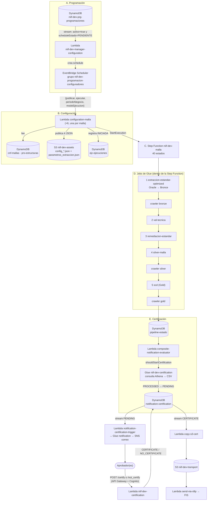

# Flujo integral del proceso NIIF 17 (pasos 2 y 3), de punta a punta

**Fuente:** el código y la configuración desplegados en la cuenta `533267035849` (us-east-1, DEV), extraídos el 2026-11-03: los 11 jobs de Glue (`Backend\Glue\`), las 6 Step Functions (`Backend\StepFunctions\`), las lambdas (`Backend\Lamnbdas\`, incluida `pruebas-lambda\`), los triggers de DynamoDB y las reglas de EventBridge (`Backend\Eventos\`). No se vieron ejecuciones reales ni los JSON de configuración que viven en S3: lo marcado **(inferido)** sale de leer el código.

**Alcance:** las 6 mallas (Primas Rentas, Primas Endosos, Primas ARL, Auxilios Funerarios, Reserva Matemática ARP y RVI). Reemplaza el resumen disperso de `lambdas.md` y `step-functions-niif.md`, que siguen siendo el detalle por componente.

---

## 1. El proceso en una página

Una **programación** (fila en DynamoDB) dispara un **configurador**, que valida la configuración de la malla, publica sus parámetros en S3 y arranca una **Step Function**. La Step Function encadena jobs de Glue (extraer → validar → remediar → preparar Silver → consolidar Gold) y, al final, lanza el job de **certificación**, que genera los reportes y abre la cadena de aprobación y transporte. Los jobs **no se pasan datos entre sí**: se pasan un archivo de estado en S3 (`parametros_extraccion.json`).

---

## 2. Paso a paso

### A. Programación
1. Alguien (hoy se hace a mano; **no se encontró una pantalla o API**, por confirmar) escribe en `niif-dev-prg-programaciones` una fila `PK = PROGRAMACION#<MALLA>`, `SK = METADATA`, con `activo`, `scheduleExpression` (cron o `at(...)`), `scheduleName`, `periodoNegocio`, `modoEjecucion` y `scheduleEstado = PENDIENTE`.
2. El **stream** de la tabla, con filtro `activo = true` y `scheduleEstado = PENDIENTE`, invoca `niif-dev-manager-configuration`.
3. El manager lee la fila, crea el schedule en EventBridge Scheduler (grupo `niif-dev-programacion-configuradores`) con destino la lambda configuradora de esa malla, y actualiza `scheduleEstado`. Si la expresión es `at(...)`, el schedule se borra solo al ejecutarse. El mapeo malla → lambda viene de la variable `CONFIGURADORES_JSON`.
4. Cuando llega la hora, el Scheduler invoca al configurador con `{"publicar": true, "ejecutar": true, "periodoNegocio": "...", "modoEjecucion": "NORMAL", "origen": "PROGRAMACION_GESTOR"}` y hasta 2 reintentos.

### B. Configuración (lambda `niif-dev-configuration-<malla>`)
5. Lee los registros de la malla en `cnf-mallas` (`PK = MALLA#<MALLA>`): `EXTRACCION`, `VALIDACION`, `REMEDIACION`, `SCD` y los `CICLO#n`. Cada uno trae la ruta S3 de su archivo activo (`archivoActivoUri`).
6. Lee las estructuras de `prs-estructuras` y construye 4 JSON de parámetros con el periodo del evento.
7. Si `publicar`: **actualiza el periodo en `cnf-mallas`** y escribe los 4 JSON en `s3://niif-dev-assets/<malla>/`.
8. Si `ejecutar`: arranca la Step Function con el nombre `<malla>-<periodo>-auto-<marca>-<id>` y escribe la fila `INICIADA` en `ejc-ejecuciones` (`PK = EJC#<MALLA>#<periodo>`, `SK = EJECUCION#<nombre>`).

### C. Step Function `niif-dev-<malla>`
Cada malla tiene su copia. **Solo cambian las rutas S3, el nombre del job Silver y los datos de notificación.** Detalle estado por estado en `step-functions-niif.md`.

### D. Los jobs de Glue

| # | Job | Lee | Escribe | Qué hace |
|---|---|---|---|---|
| 1 | `niif-dev-extraccion-estandar-optimized` (66 KB) | `config_extraccion_<malla>.json` (S3) y **Oracle** vía la conexión `datalake-dev-alfaprd-dev-connection` (`SELECT * ... WHERE`, fetch 10 000) | Parquet en **Bronce** (`alfa-datalake-dev-bronce/niif/...`, con `lote_cargue_id`) y `parametros_extraccion.json` | Extrae las tablas por segmentos y ciclos, con *checkpoint* para reanudar. Decide si hay datos nuevos (`requiere_procesamiento_caso`). |
| 2 | `niif-dev-val-tecnica` | `config_val_tec` y `parametros_extraccion.json`; exige `estado_extraccion = SUCCESS` | Tabla `validacion_tecnica_<malla>` (Silver) y el estado en el JSON | Validaciones técnicas sobre lo extraído. Puede dejar `validacion_tecnica_detiene_flujo` y `requiere_revision_analitica`. |
| 3 | `niif-dev-remediacion-estandar` | Origen: la validación técnica | `s3://.../niif/remediacion/<malla>/lote_cargue_id=N/` y estado | Copia a Silver los datasets; en lotes con hallazgos aplica la remediación. |
| 4 | `niif-dev-silver-<malla>` (uno por malla) | Datasets disponibilizados (`ruta_dataset_destino`) | `silver_preparado_<malla>` | Une y prepara los datos de negocio. Exige `estado_remediacion = SUCCESS`; acepta validación `FAILED`. |
| 5 | `niif-dev-scd` | `config_scd` y `ruta_silver_preparada` | `alfa-datalake-dev-gold/niif/scd_<malla>/` | Consolida en Gold como dimensión de cambio lento. Si no hay datos, inicializa Gold vacío. |
| 6 | `niif-dev-certification` | Config de certificación (`niif-dev-assets/configs/...`), **Athena** sobre Gold | CSV en S3 y filas en `notification-certification` | Ver sección E. |

**Cómo se pasan el trabajo:** cada job lee `parametros_extraccion.json`, comprueba el estado del anterior (`estado_extraccion`, `estado_validacion`, `estado_remediacion`, `estado_preparacion_silver`, ...), hace lo suyo y **reescribe el mismo JSON** con su propio estado, rutas, fechas y métricas. Es, en la práctica, el manifiesto que pedía la propuesta de `riesgos-glue-notificacion`, pero con un archivo fijo por malla (riesgo FLU-02 en `revision-pre-produccion.md`).

**Crawlers:** tras Bronce, Silver y Gold, la Step Function lanza `niif-dev-crawler-bronze/silver/gold` y consulta su estado cada 20 s. Actualizan el catálogo `niif-dev-*-catalog-db` para que Athena vea los datos.

### E. Certificación
9. Al terminar los crawlers, la Step Function escribe `PIPELINE_COMPLETO` en `niif-dev-pipeline-estado` y llama a `niif-dev-composite-notification-evaluator`.
10. La lambda decide: **SIMPLE** (la malla notifica sola), **COMPOSITE_WAITING** (faltan mallas del grupo; guarda `READY_TO_NOTIFY` en `composite-notification-status`), **COMPOSITE_READY** (la última malla toma un *lock* y notifica por todo el grupo) o **COMPOSITE_ALREADY_LOCKED**. Reserva Matemática ARP y RVI comparten un solo correo por esto.
11. Solo si `shouldStartCertification = true`, la Step Function lanza el job `niif-dev-certification`.
12. El job ejecuta las consultas del caso en **Athena**, descarga el resultado como CSV al bucket de reportes y escribe en `niif-dev-notification-certification` filas con `useCaseId`, `executionId`, `period`, `certCode`, `s3_url` y estado `PROCESSED`; luego las pasa a `PENDING`.
13. El **stream** de esa tabla, con `status = PENDING`, dispara `notification-certification-trigger` (su código no se extrajo; solo se conocen sus variables y que lanza el job de Glue de notificación).
    El job **`niif-dev-notification-certification`** (`Backend\Glue\`, código completo) es quien arma y envía el correo:
    - lee la configuración global y la del caso (`email.subject`, `stringVars`, `destinations`) desde `niif-dev-assets`;
    - consulta Athena para armar las tablas de **resumen** y **totales**, y crea enlaces cortos (`niif-dev-short-links`) para Certificar, No certificar y descargar cada CSV;
    - **publica en SNS** (`niif-dev-certification-email`) un **mensaje de texto plano** por destinatario, con el asunto cortado a 100 caracteres. Antes de enviar, reconfigura el `FilterPolicy` por `recipient` de las suscripciones;
    - marca las filas como `SENT` y cierra el grupo compuesto.
    Si el caso se regenera sin datos nuevos, antepone `[REGENERADO]` al asunto y un aviso al cuerpo. Las plantillas HTML (`Backend\htmlNew\`) **no se usan en ningún punto del código**.
14. El aprobador usa el enlace → `POST /certify` o `/not_certify` (API Gateway con Cognito) → lambda `niif-dev-certification`. Si el caso exige varios aprobadores, deja `PENDING_APPROVERS` hasta completar `approvers.required`; cada voto se audita en `approval-audit-log`.
15. El estado final (`CERTIFICATE` o `NO_CERTIFICATE`) dispara por **stream** a `copy-s3-cert` (copia a `niif-dev-transport` y de ahí `send-via-sftp` a FIS) o a `move-s3-certification`.

### F. Cuando algo falla (qué existe hoy)
- **Dentro de la Step Function:** cada job y cada crawler tiene un `Catch` hacia su estado de registro de fallo. Al fallar escribe `FAILED` con el paso fallido y `reanudar_desde` en `pipeline-estado`, marca `FAILED` en `ejc-ejecuciones` y termina en `EJCFailState`. La ejecución queda en estado `FAILED`.
- **Aviso al equipo:** la regla `ALFA-DEV-DATALAKE-SfnEvents` envía el fin de **cualquier** Step Function a la lambda `PipelineObserver`. Si el estado no es `SUCCEEDED`, publica en SNS: `ALFA-DEV-DATALAKE-Critical` (FAILED y TIMED_OUT) o `...-Warning` (ABORTED), con los pasos fallidos, el error y el enlace a la consola. Ambos tópicos tienen suscriptores de correo.
- **Jobs y crawlers:** `PipelineObserver` solo publica **métricas** (`GlueJobFailed`, `CrawlerFailed`, duración, DPU-horas). No envía aviso por sí solo; el aviso sale únicamente si ese fallo hace fallar la Step Function.
- **No hay aviso** para fallos fuera de la Step Function: el configurador (la invocación del Scheduler se reintenta 2 veces y se descarta), el manager, el job de notificación, las lambdas de los streams (`copy-s3-cert`, `move-s3-certification`) ni el envío por SFTP. Tampoco hay alerta de rebote del correo (la regla de SES `niif-dev-ses-delivery-test` solo escribe a un log).
- **Logs:** las Step Functions tienen el registro de ejecución apagado y las lambdas escriben en texto plano; no hay formato común.

---

## 3. Tablas de DynamoDB

| Tabla | Quién escribe | Quién lee | Para qué |
|---|---|---|---|
| `niif-dev-prg-programaciones` | Operador (a mano) y manager (estado del schedule) | manager; **stream** | Cuándo, qué malla y qué periodo |
| `niif-dev-cnf-mallas` | Configurador (periodo) | Configurador | Registros de configuración por malla (extracción, validación, remediación, SCD, ciclos) |
| `niif-dev-prs-estructuras` | Nadie en este flujo (carga externa, por confirmar) | Configurador | Estructuras de las tablas fuente |
| `niif-dev-ejc-ejecuciones` | Configurador (`INICIADA`) y Step Function (`SUCCEEDED` / `FAILED`) | Step Function | Una fila por ejecución |
| `niif-dev-pipeline-estado` | Step Function (54 escrituras entre las 6) | Step Function | Estado por `dev#<caso>#<periodo>`: último paso exitoso, paso fallido y `reanudar_desde` |
| `niif-dev-composite-notification-status` | `composite-notification-evaluator` | **stream** → el mismo evaluador | Miembros listos y *lock* de grupos |
| `niif-dev-notification-certification` | Job de certificación y lambda `niif-dev-certification` | Triggers por **stream**; índice `certCode-index` | Ciclo de vida de la certificación |
| `niif-dev-short-links` | Trigger de notificación | `short-link-redirect`, composite | Enlaces cortos del correo |
| `niif-dev-approval-audit-log` | `niif-dev-certification` | `niif-dev-certification` | Auditoría de aprobadores |
| `datalake-dev-use-case-queries`, `-use-case-emails`, `-use-case-approvers` | Carga externa | Triggers y lambdas de certificación | Consultas, destinatarios y aprobadores. **Son del datalake anterior**, no `niif-dev` |
| `niif-dev-gestor-configuracion`, `niif-dev-programacion-cargues` | Generación 2 | Generación 2 | Solo la generación anterior (`programador-cargues`, `iniciador`, `finalizador`) |

### Estados de `notification-certification`
`PROCESSED → PENDING → PENDING_APPROVERS (varios aprobadores) → CERTIFICATE | NO_CERTIFICATE → TRANSPORT | NO_TRANSPORT`

### Los 3 streams que mueven el proceso
| Stream | Filtro | Lambda |
|---|---|---|
| `prg-programaciones` | `activo = true` y `scheduleEstado = PENDIENTE` | `manager-configuration` |
| `notification-certification` | `PENDING` (INSERT y MODIFY) | `notification-certification-trigger` |
| `notification-certification` | `CERTIFICATE` / `NO_CERTIFICATE` (MODIFY) | `copy-s3-cert` / `move-s3-certification` |
| `composite-notification-status` | sin filtro | `composite-notification-evaluator` |

---

## 4. Dónde viven los datos en S3

| Bucket / ruta | Contenido |
|---|---|
| `niif-dev-assets/<malla>/` | `config_extraccion_*.json`, `config_val_tec_*.json`, `config_remediacion_*.json`, `config_scd_*.json`, `parametros_extraccion.json` (el estado) y `plantillas/` |
| `niif-dev-assets/configs/certification/` | Configuración global de certificación y de cada caso |
| `alfa-datalake-dev-bronce/niif/<ACSELE\|ALFAPRD>/...` | Copia de las fuentes, con `lote_cargue_id` |
| `alfa-datalake-dev-silver/niif/remediacion/<malla>/` | Remediación por lote |
| `alfa-datalake-dev-silver/niif/t_data_domain/<malla>/` | `validacion_tecnica_`, `silver_preparado_` y `tmp_preparacion_` |
| `alfa-datalake-dev-gold/niif/scd_<malla>/` | Resultado final |
| Bucket de reportes (`niif-dev-certification`) y `niif-dev-transport` | CSV de certificación y archivos listos para FIS |

---

## 5. Las 6 mallas en una tabla

| Malla | Job Silver | Caso de notificación | Notificación |
|---|---|---|---|
| Primas Rentas | `silver-primas-rentas` | `primasRentas` → `primas-rentas/primasRentasEndosos.json` | Compartida con Endosos |
| Primas Endosos | `silver-primas-endosos` | (ídem, grupo) | Compartida con Rentas |
| Primas ARL | `silver-primas-arl` | `primasArl` | Propia |
| Auxilios Funerarios | `silver-auxilios-funerarios` | `auxilioFunerario` | Propia; la única que usa `fecDesde` / `fecHasta` |
| Reserva Matemática ARP | `silver-reserva-matematica-arp` | `reservaMatematicaArp` → `reserva-matematica/reservaMatematicaRviArp.json` | Compartida con RVI |
| Reserva Matemática RVI | `silver-reserva-matematica-rvi` | `reservaMatematicaRvi` | Compartida con ARP |

---

## 6. Dónde seguir leyendo

Este documento describe **cómo funciona hoy** el proceso. El resto del análisis está separado:

| Documento | Para qué |
|---|---|
| `jobs-glue.md` (esta carpeta) | Cada job de Glue por dentro: qué lee, qué escribe, argumentos y cómo se pasan el estado |
| `tareas-sobre-el-flujo.md` (esta carpeta) | Cómo se conectan las tareas asignadas (T1, T2, T3) con este flujo y qué falta para hacerlas |
| `Docs\06-brechas\rendimiento-y-costos.md` | Problemas actuales de rendimiento y costo, con evidencia |
| `Docs\06-brechas\revision-pre-produccion.md` | Lista priorizada de lo que hay que corregir antes de producción |
| `Backend\Lamnbdas\inventario-aws\lambdas.md` y `step-functions-niif.md` | Detalle por lambda y por estado de la Step Function |

---

## 7. Lo que no se pudo ver
1. **Código de la cadena final** (notification trigger, copy, move, SFTP), para confirmar los pasos 13 y 15.
2. **Los JSON de S3** (`config_*`, `json_global_notif_cert.json`, `composite_groups.json`): definen qué tablas lee cada job, qué consultas corre Athena y quién aprueba. Son lo que más explicaría el comportamiento real.
3. **Una ejecución real** (historial de una Step Function) para ver tiempos, costos y fallos.
4. **Quién crea las programaciones** y cómo se hace hoy.
5. **Cuál generación del gestor es la oficial** (G3 o G4); este documento describe G4 (`manager-configuration` → `configuration-<malla>`).
6. **Las políticas IAM de cada rol** (los roles de los jobs y lambdas se conocen por nombre, no por permisos).