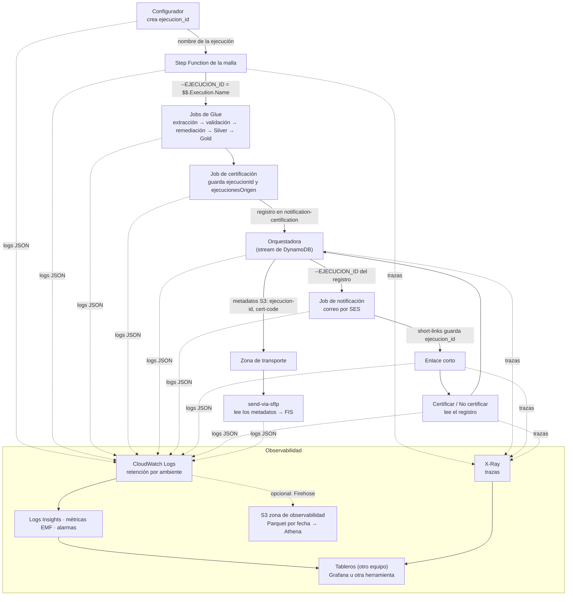

# Informe técnico: observabilidad de NIIF 17 en AWS (jobs de Glue y lambdas)

**Fecha:** 2026-11-19
**Estado:** propuesta para revisión. Aún no hemos cambiado código ni infraestructura.
**Alcance:** los componentes AWS a nuestro cargo: los jobs de Glue del medallón (paso 2), las Step Functions de las mallas, y las lambdas y jobs de notificación, certificación y transporte (paso 3).

## 1. Objetivo y alcance
Con este informe buscamos que el proyecto tenga observabilidad completa, de manera que ante cualquier falla en producción podamos:

1. **Seguir una petición de punta a punta.** Con un solo ID (`ejecucion_id`) se debe ver todo lo que pasó en una corrida: configurador → Step Function → cada job de Glue → certificación → correo → Certificar / No certificar → copia a transporte → envío a FIS.
2. **Saber cuánto dura cada parte:** la corrida completa, cada job y cada paso dentro del job (leer, validar, escribir, etc.).
3. **Tener contexto completo en cada línea de log (MDC):** malla, periodo, paso, `cert_code` y versión de configuración.
4. **Responder preguntas técnicas y de negocio** sobre la operación (sección 6).
5. **Dejar todo publicado y documentado** para que otro equipo construya los tableros con la herramienta que elija (Grafana, CloudWatch Dashboards, QuickSight, Power BI u otra). Nuestro trabajo llega hasta ahí: no construimos tableros ni definimos la herramienta.
6. **Poder avisar en el futuro:** las mismas métricas y eventos sirven de base para alarmas (fase 6).

### Los tres niveles de observabilidad
| Nivel | Pregunta que responde | Qué emitimos | Dónde queda |
|---|---|---|---|
| **Logs** | ¿Qué pasó exactamente, con qué contexto y qué error? | Una línea JSON por evento, según el contrato de la sección 4: contexto completo (MDC), conteos y error clasificado | CloudWatch Logs (consultable con Logs Insights) |
| **Métricas** | ¿Cuántas veces, cuánto tarda, cuántas filas, cuántos errores? ¿Hay que avisar? | Métricas EMF desde el código (`DuracionMs`, `Filas*`, `Errores`, `Reintentos`) y métricas nativas de Glue, Lambda, Step Functions y API Gateway | CloudWatch Metrics; son la base de las alarmas (fase 6) |
| **Trazas** | ¿Por dónde pasó la petición y cuánto duró cada tramo? | X-Ray activo en lambdas, Step Functions y API Gateway. Glue no soporta X-Ray, así que ahí la traza sale de los logs: `ejecucion_id` como ID de traza y `PASO_INICIO`/`PASO_FIN` como tramos con `duracion_ms`. La Step Function en nivel `ALL` da el tramo de cada job | X-Ray y CloudWatch Logs Insights |

Las preguntas técnicas y de negocio se responden combinando los tres niveles.

## 2. Punto de partida
Antes de proponer cambios revisamos lo que ya existe en el proyecto:

- **Estándar de logs del equipo** (`Docs\08-estandares-desarrollo\estandar-lambdas-python.md` §5): ya exige logs JSON en español, `ejecucion_id`, `request_id`, `cert_code`, un catálogo cerrado de eventos y métricas EMF. Lo tomamos como base del contrato de la sección 4.
- **Librería común `niif_observability`:** existe en la rama `feature/codigo-nuevo-notificacion`, con 7 copias idénticas. Ofrece un logger JSON con contexto (`bind()`, equivalente al MDC) y métricas EMF. Todavía no mide duración ni incluye `malla`, `etapa`, `paso`, `resultado` ni `config_version`.
- **ID de punta a punta (ARQ-32):** sigue abierto. Ninguno de los 47 `startJobRun` de las 8 Step Functions de la IaC pasa `$$.Execution.Name` a los jobs; `$$.Execution.Id` solo se escribe en DynamoDB como estado de la corrida. Lo mismo en lo desplegado: ninguna de las 24 Step Functions de NIIF en DEV menciona `EJECUCION_ID`.
- **Certificación:** el job de la rama feature ya guarda `ejecucionId` en el registro de notificación. En `main` sigue generando un `uuid4` por consulta.
- **Logs de Step Functions (ARQ-12):** confirmamos en la IaC que el módulo `step-functions` 5.0.2 se usa sin `logging_configuration`.
- **Avisos que ya existen** (detalle en `Docs\05-arquitectura\flujo-integral-niif17.md`, sección F). La plataforma tiene una lambda `ALFA-DEV-DATALAKE-PipelineObserver`, del stack de CloudFormation `stack-cf-observability` ("Plataforma de Observabilidad Data Platform", creado en octubre de 2026, fuera de nuestra IaC y sin etiquetas de dueño), que recibe por EventBridge el fin de todas las Step Functions y de todos los jobs de Glue y crawlers:
  - si una Step Function termina en `FAILED`, `TIMED_OUT` o `ABORTED`, publica un aviso en los SNS `ALFA-DEV-DATALAKE-Critical` o `-Warning`, cada uno con una sola suscripción por correo;
  - de los jobs de Glue y los crawlers solo publica métricas (`GlueJobFailed`, `CrawlerFailed`, duración, DPU-horas): un job que falla avisa únicamente si hace fallar su Step Function;
  - no hay aviso para lo que falla fuera de una Step Function: configuradores, job de notificación, lambdas de la cadena de certificación, envío por SFTP ni rebotes de correo.
  `PipelineObserver` también publica en el espacio de métricas `ALFA/DATALAKE` la duración y las DPU-horas de cada job y la duración de cada paso de la Step Function: ya hay datos de duración por job sin tocar nuestro código.
  Además existe una aplicación de CloudWatch Application Insights (`niif-dev`) con alarmas, pero ninguna tiene acción configurada: no avisan a nadie.

## 3. Diagnóstico por repositorio
Revisamos el código de la rama `main` de los 28 repositorios y la IaC. Leyenda: **Texto** = mensajes libres con `logging` o `print`; **JSON** = una línea JSON por evento.

### Jobs de Glue
| Repo | Formato | ID de flujo | Duración | Conteos | Riesgos | Cambio propuesto | Fase |
|---|---|---|---|---|---|---|---|
| `rmd-ext-estandar` (extracción, remediación, SCD y validación; lo usan las 6 mallas) | Texto (138 líneas) | No | Sí, en texto (lectura, conteo y escritura por tabla) | En texto | — | Pasar a eventos con `duracion_ms` y conteos; es el de mayor alcance | 2a |
| `auxilios-funerarios` (Silver, validación técnica y Gold SCD genéricos) | Texto | No | No | Parcial, en texto | — | Igual al anterior | 2a |
| `certification` | Texto | `executionId` = `uuid4` por consulta (ARQ-32) | No | No | SQL completo en el log (SEG-15) | Ya resuelto en la rama feature; desplegarla | 2a |
| `notification-certification` | `print` en texto | No | No | 1 | **Correos de destinatarios y enlaces en el log (SEG-17)** | Ya resuelto en la rama feature (eventos `NTF_*`); desplegarla | 2a |
| `primas-arl` (Bronce y Silver) | Texto | No | No | 1 | — | Instrumentación mínima | 2b |
| `primas-rentas`, `primas-endosos`, `reserva-matematica-arp`, `reserva-matematica-rvi` (Silver) | Texto | No | No | 1 a 4 | — | Instrumentación mínima | 2b |
| `pcr-emisiones` | Texto | No | Sí, en texto | No | `except Exception: pass` (l. 2988) | Instrumentación mínima y eliminar el `pass` | 2c |
| `primas-previsional` | `print` (18) y texto | No (usa `LOTE_CARGUE_ID`) | No | 2 | `except Exception: pass` (`gestor_archivos_previsional.py` l. 191) | Instrumentación mínima | 2c |
| `emisiones-vida` | `print` (4) | No | No | No | — | Instrumentación mínima (versión de prueba) | 2c |

Común a los 12 repositorios: ninguno recibe `--EJECUCION_ID` ni registra el `JOB_RUN_ID`. En DEV, cada corrida deja logs en tres grupos: `/aws-glue/jobs/logs-v2` (logs continuos de Spark, un flujo para el driver y uno por executor), `/aws-glue/jobs/output` (salida estándar, donde terminan los `print`) y `/aws-glue/jobs/error` (salida de error). El `logging` de Python, configurado con `basicConfig`, escribe a la salida de error, así que los mensajes del código quedan mezclados con miles de líneas de Spark. Todos los flujos se nombran con el `JobRunId`, que hoy no se cruza con la ejecución de la Step Function. Por eso, encontrar los mensajes de una corrida exige saber primero su `JobRunId`.

### Lambdas
| Repo | Formato | ID de flujo | Duración | Riesgos | Cambio propuesto | Fase |
|---|---|---|---|---|---|---|
| `conf-*` (6) y `configuration-general` | JSON con `request_id` | **Crean el ID raíz** (`<malla>-<periodo>-auto-<marca>-<req8>`) y el registro `EJC#` | No | `except: pass` en `case_registry.py` l. 155 | Emitir `EJECUCION_INICIADA` con el ID raíz | 3 |
| `notification-certification` (trigger) | Texto | Solo `cert_code` | No | Registra la `NewImage` completa (SEG-12); reporta éxito aunque falle (ARQ-26) | La reemplaza la orquestadora (rama feature) | 3 |
| `copy-s3-certification`, `mov-s3-certification` | Texto | `executionId` del registro (no es el del flujo) | No | Reportan éxito aunque fallen (ARQ-26) | Las reemplaza la orquestadora | 3 |
| `composite_notification_evaluator` | `print` en JSON | `sourceExecutionId` | No | — | Pasar a la librería común | 3 |
| `certification` (Certificar / No certificar) | Texto | No | No | Correo del aprobador en el log (SEG-07); no registra el resultado (ARQ-33) | Un evento por cada salida, con el aprobador enmascarado | 3 |
| `short-link-redirect` | `print` | No | No | **Registra la petición HTTP completa y `token -> URL` (SEG-17)** | Evento sin token ni cabeceras | 3 |
| `send-via-sftp-lambda` | Texto | No | Sí, en texto | 5 `except: pass` (ARQ-56) | Leer el ID de los metadatos del objeto S3; un evento por archivo | 3 |
| `get-files-sftp` | Texto | No | Sí, en texto | 4 `except: pass` (ARQ-56) | Un evento por archivo, con su propio ID de corrida | 3 |
| `configurador-mallas`, `notification-certification-orchestrator`, `post-login` | — | — | — | Solo existen en ramas feature | Nacen con la librería v2 | 3 |

### Infraestructura (IaC)
| Pieza | Situación actual | Brecha |
|---|---|---|
| 47 jobs de Glue (dos repos IaC) | `--enable-continuous-cloudwatch-log`, `--enable-metrics` y `--enable-job-insights` activos en todos. En DEV, los jobs que usan las mallas (`niif-dev-*` del repo `operations-manager`) tienen logs continuos y métricas, pero no `--enable-observability-metrics` | Falta `--enable-observability-metrics`. Los grupos `/aws-glue/jobs/*` en DEV no tienen retención (nunca expiran) |
| 8 Step Functions | Permiso de X-Ray en la política; **sin `logging_configuration`**. En DEV, las 24 Step Functions de NIIF tienen los logs en `OFF`; las de la IaC sí tienen X-Ray activo | ARQ-12 / ARQ-52 |
| Lambdas (módulo `lambda` 7.9.0) | Políticas de logs y de X-Ray adjuntas; **sin `tracing_mode`** ni retención. En DEV, todas las lambdas de NIIF están en `PassThrough` (sin X-Ray propio), con formato `Text` y grupos de logs sin retención | ARQ-52, COS-10 |
| API Gateway | Logs de ejecución en INFO, métricas y X-Ray activos. En DEV, la etapa `dev` también tiene logs de acceso en `/aws/apigateway/datalake-dev-niif-api-gtw` (sin retención) | Formato de los logs de acceso por revisar (que lleve el `requestId`) |
| Alarmas | **Ninguna en nuestra IaC.** En DEV, Application Insights (`niif-dev`) creó alarmas sobre API Gateway, tablas DynamoDB, 6 lambdas, el SNS de certificación y las Step Functions de solo `primas-arl`, `primas-rentas` y `emisiones`. **Ninguna tiene acción** y OpsCenter está apagado: no avisan a nadie | ARQ-51 |
| Reglas de EventBridge | **Ninguna para fallos en nuestra IaC.** En DEV, las reglas de plataforma `ALFA-DEV-DATALAKE-GlueJobEvents` y `-SfnEvents` envían el fin de todos los jobs de Glue y todas las Step Functions a `PipelineObserver`. La regla `niif-dev-finalizar-ejecucion-primas-arl` (solo ARL) va a una lambda de la generación anterior (ARQ-12) | Avisos solo por fallo de Step Function (ver sección 2) |
| Tableros y filtros de suscripción | Ninguno. No hay métricas EMF propias de NIIF; las únicas métricas de ejecución son las de plataforma de `PipelineObserver` | — |
| SNS | Nuestra IaC solo crea `certification_email`. En la cuenta existen los SNS de plataforma `ALFA-DEV-DATALAKE-Critical` y `-Warning`, con suscripción por correo | Reutilizarlos para las alertas técnicas, en acuerdo con su dueño |
| Estado de la corrida | `ejc-ejecuciones` (una fila por ejecución, 6 mallas; en DEV sin TTL, con recuperación a un punto en el tiempo y sin exportaciones a S3) y `pipeline-estado` (llave `amb#malla#periodo`, **se sobrescribe**: solo queda el último estado) | ARQ-55; falta la exportación a S3 que pide HU-GI-05 para los 7 años |

## 4. Contrato de log v1
Respetamos los nombres que ya usa el código (`niif_observability`) y agregamos los que faltan. Los nombres deben ser estables: cambiar uno rompe los tableros que se construyan encima.

**Campos que van siempre:** `marcaTiempo` (ISO-8601 UTC), `nivel`, `evento`, `mensaje` (en español), `funcion` (componente), `esquema` = `niif17-log/1`, `ambiente`, `ejecucion_id` y `request_id` (`aws_request_id` en lambda, `JOB_RUN_ID` en Glue).

**Contexto de negocio (MDC, se fija una vez con `bind`):** `malla`, `use_case_id`, `periodo_negocio`, `cert_code` (desde la certificación), `lote_cargue_id` (si aplica) y `config_version`.

**Campos por paso:** `etapa` (`configuracion`, `extraccion`, `validacion`, `remediacion`, `silver`, `gold`, `certificacion`, `notificacion`, `aprobacion`, `transporte`), `paso` (nombre estable, p. ej. `leer_oracle`, `escribir_gold`), `duracion_ms` y `resultado` (`OK`, `ERROR`, `PARCIAL`, `OMITIDO`).

**Datos (sin datos personales):** `filas_entrada`, `filas_salida`, `filas_cuarentena`, `suma_control` (suma del importe principal), `origen`, `destino` (tabla o prefijo, nunca la fila) y `bytes`.

**Error:** `error_codigo`, `error_dominio`, `error_severidad`, `error_recuperable` (taxonomía de HU-GI-06) y `error_tipo` (clase de la excepción). Nunca se registran valores de filas, SQL completo, tokens ni correos.

**Eventos comunes de ciclo de vida.** Todos los componentes los emiten; cada uno puede tener además los suyos, como los `NTF_*` del job de notificación.

| Evento | Quién lo emite | Campos clave |
|---|---|---|
| `EJECUCION_INICIADA` | configuradores | `ejecucion_id` raíz, `malla`, `periodo_negocio`, `modo` |
| `COMPONENTE_INICIO` / `COMPONENTE_FIN` | cada job y lambda | `duracion_ms`, `resultado`, totales |
| `PASO_INICIO` / `PASO_FIN` | cada paso interno | `etapa`, `paso`, `duracion_ms`, conteos |
| `CUADRE_RESULTADO` | validación, remediación, SCD | `filas_entrada = filas_salida + filas_cuarentena`, diferencia |
| `ERROR_CLASIFICADO` | todos | campos de error |
| `CERTIFICACION_GENERADA`, `NOTIFICACION_ENVIADA`, `DECISION_REGISTRADA`, `TRANSPORTE_COPIADO`, `ARCHIVO_ENVIADO_SFTP` | cadena del paso 3 | `cert_code`, `resultado`, aprobador enmascarado |

**Métricas EMF:** espacio de nombres `NIIF17/<componente>`; dimensiones solo `ambiente`, `malla`, `etapa` y `resultado`; métricas `DuracionMs`, `FilasEntrada`, `FilasSalida`, `FilasCuarentena`, `Errores` y `Reintentos`. **Nunca** usamos `ejecucion_id`, `cert_code` ni periodo como dimensión, porque cada valor distinto crea una métrica nueva que se cobra.

**Librería `niif_observability` v2.** Proponemos ampliar la librería actual con:
- un bloque `with paso(...)` que emite `PASO_INICIO` y `PASO_FIN` con `duracion_ms` y `resultado`, también cuando hay una excepción (que se vuelve a lanzar);
- los campos nuevos del contrato;
- enmascarado de correos y tokens;
- una variante para Glue que escribe a *stdout* y toma el `JOB_RUN_ID`.

Debe haber una sola fuente: en Glue, por `--extra-py-files` desde el bucket de assets; en las lambdas, una copia verificada con `verificar_copias_comunes.py`.

## 5. Recorrido del ID y destino de los logs

- **Grupos de mallas (evaluador compuesto):** cuando Rentas + Endosos o ARP + RVI se certifican juntas, una sola certificación viene de **varias** corridas. El job de certificación de la rama feature ya guarda `ejecucionesOrigen` (lista) junto a su `ejecucion_id`. Los logs y el Modelo Trazabilidad deben llevar esa lista para unir la traza de cada malla con la certificación común.
- **Duración por job sin tocar código:** `PipelineObserver` ya publica la duración de cada job y de cada paso de la Step Function (sección 2). Además, con los logs de la Step Function en nivel `ALL` y `include_execution_data = false` obtenemos la hora de entrada y salida de cada estado (cada job) por ejecución. Glue ya publica `ExecutionTime` y DPU por corrida. El código solo debe aportar la duración de los pasos internos.
- **X-Ray** activo en lambdas y Step Functions como complemento; en Glue la traza se arma con los logs.
- **Destino:** proponemos CloudWatch Logs como origen único. La copia a S3 para histórico y Athena es opcional y solo la haríamos si se exige una retención larga (ver 7.1). OpenSearch o Elastic solo se justificarían si aparece un requisito de búsqueda o retención que esto no cubra.

## 6. Preguntas que la solución debe responder
| Pregunta | Señal | Cómo se responde |
|---|---|---|
| ¿Dónde falló la corrida X y con qué error? | Logs + trazas | Logs Insights: `fields marcaTiempo, funcion, etapa, paso, evento, error_codigo, mensaje \| filter ejecucion_id = "<id>" \| sort marcaTiempo asc` |
| ¿Qué paso es el más lento por malla? | Logs + trazas | `filter evento = "PASO_FIN" \| stats avg(duracion_ms), pct(duracion_ms, 95), max(duracion_ms) by malla, etapa, paso` |
| ¿Cuánto tardó cada job en la última corrida? | Trazas | Logs de la Step Function (`TaskStateEntered` / `TaskStateExited`) o `COMPONENTE_FIN` |
| ¿Qué jobs fallaron esta semana? | Métricas | EventBridge `Glue Job State Change` FAILED/TIMEOUT y métrica `Errores` |
| ¿Cuántos reintentos hubo y en qué paso? | Métricas | Métrica `Reintentos` por `etapa` |
| ¿Cuadran las filas entre Bronce, Silver y Gold? | Logs | `filter evento = "CUADRE_RESULTADO" \| fields malla, periodo_negocio, etapa, filas_entrada, filas_salida, filas_cuarentena` |
| ¿El total de montos se mantuvo entre capas? | Logs | `suma_control` por `etapa` y `ejecucion_id` |
| ¿Se certificó la malla M del periodo P, quién (enmascarado) y cuándo? | Logs | `DECISION_REGISTRADA` y la tabla de aprobaciones |
| ¿Cuánto tarda el negocio en certificar? | Logs | Diferencia entre `NOTIFICACION_ENVIADA` y `DECISION_REGISTRADA` por `cert_code` |
| ¿Qué certificaciones llevan más de N días pendientes? | Logs | Tabla `notification-certification` (índice `status-pendingDate-index` de la orquestadora) |
| ¿Llegó el archivo a FIS? | Logs + trazas | `ARCHIVO_ENVIADO_SFTP` con `cert_code` |
| ¿Cuánto cuesta cada malla en Glue y Athena? | Métricas | DPU-horas de Glue; `QueryExecutionId` y bytes escaneados en el `PASO_FIN` de certificación y notificación |

## 7. Roadmap de cambios
Las duraciones son estimadas. En cada fase entregamos el código en un zip por recurso y le solicitamos a DevOps los cambios de IaC, según el estándar de gobierno DevOps.

| Fase | Qué | Repos | Entregable / criterio de cierre | Estimado |
|---|---|---|---|---|
| **0. Contrato y decisiones** | Aprobar el contrato v1, el catálogo de eventos comunes, los nombres de métricas, la retención por ambiente y el destino de los logs | `Docs\08-estandares-desarrollo` | Contrato aprobado; `niif_observability` v2 especificada | 1-2 d |
| **1. ID de punta a punta (ARQ-32)** | `--EJECUCION_ID.$ = $$.Execution.Name` (y `--MALLA`, `--PASO.$ = $$.State.Name`) en los 47 `startJobRun` y en la carga útil de las tareas Lambda; la certificación guarda `ejecucionId`; `short-links` guarda `ejecucion_id`; la copia a transporte escribe metadatos S3; prueba automática sobre las ASL | `iac-...-operations-manager` (datafiles), `certification` (rama feature), orquestadora, `short-link-redirect`, `send-via-sftp` | Script que falla si una tarea no lleva el ID; una corrida en DEV con el mismo ID en todos los logs | 3-4 d |
| **2a. Glue de mayor alcance** | Librería v2 en Glue; `rmd-ext-estandar` y `auxilios-funerarios` (genéricos de las 6 mallas); despliegue de `certification` y `notification` de la rama feature | 4 repos de Glue | Cada paso con `PASO_FIN`, conteos, `CUADRE_RESULTADO` y `suma_control` | 5-6 d |
| **2b. Silver por malla** | Instrumentación mínima, sin reescribir: MDC al arrancar, pasos con duración, conteos y errores clasificados | `primas-arl`, `primas-rentas`, `primas-endosos`, `reserva-matematica-arp`, `reserva-matematica-rvi` | Igual a 2a | 3-4 d |
| **2c. Resto de Glue** | Igual a 2b, más eliminar los `except: pass` | `pcr-emisiones`, `primas-previsional`, `emisiones-vida` | Igual a 2a | 2-3 d |
| **3. Lambdas** | Desplegar la orquestadora (reemplaza trigger, copy y move; cierra ARQ-26 y SEG-12); `certification` (ARQ-33, SEG-07); `short-link-redirect` (SEG-17); evaluador; configuradores (`EJECUCION_INICIADA`); SFTP (ARQ-56) | 16 repos de lambdas | Una línea JSON por evento, sin datos personales; pruebas de que el ID entra y sale | 5-7 d |
| **4. IaC de observabilidad (DevOps)** | Step Functions con logs `ALL` sin datos de ejecución; `tracing_mode = Active` en lambdas y Step Functions; retención por grupo de logs como parámetro por ambiente (30 días DEV y QA, 180 días PRD); `--enable-observability-metrics`; logs de acceso del API en JSON; grupo de trabajo de Athena con tope de escaneo | 2 repos IaC | Solicitud a DevOps redactada y aplicada en DEV | 2-3 d nuestros + DevOps |
| **5. Publicación para tableros** | Consultas guardadas de Logs Insights (`aws_cloudwatch_query_definition`); diccionario de campos, eventos y métricas; guía de conexión de los orígenes (CloudWatch Logs y Metrics, X-Ray y, si se habilita, Athena), válida para cualquier herramienta. Opcional, si se exige retención larga: filtro de suscripción → Firehose → S3 Parquet → tabla de Glue y vistas de Athena (ver 7.1) | IaC + `Docs\` | Cualquier equipo puede construir tableros con la guía, sin tocar código. No incluye tableros | 3-4 d |
| **6. Alertas (futuro)** | Partir de lo que ya existe: `PipelineObserver` y los SNS `ALFA-DEV-DATALAKE-Critical` y `-Warning`. Completar lo que falta: aviso de jobs de Glue que fallan fuera de una Step Function, de los configuradores, del job de notificación, de las lambdas de certificación y del SFTP; alarmas sobre las métricas EMF de cuadre y errores; y acciones para las alarmas de Application Insights. Todo en acuerdo con el dueño de la plataforma | IaC | Según `Tareas\T1-notificaciones\propuesta-observabilidad-eventos.md` | Por definir |

**Orden recomendado:** 0 → 1 → 4 → 2a → 3 → 2b → 2c → 5 → 6.
- En la fase 4 empezamos por la parte de Step Functions y la retención, porque da la duración de cada job sin tocar código.
- La fase 1 es la que más valor aporta: sin un ID común, ningún tablero puede unir una corrida con su correo y su transporte.

## 7.1 Impacto en la infraestructura y en el diagrama
En el diagrama aprobado (`NIIF17_ModeloSolucion_V1.0.drawio`):
- solo la `Página-1` dibuja **CloudWatch** y un **Modelo Trazabilidad** (DynamoDB), sueltos y sin ninguna conexión;
- la `Página-2` (pasos 2 y 3) no dibuja nada de observabilidad (ARQ-31);
- no aparecen X-Ray, reglas de EventBridge (solo EventBridge Scheduler), Application Insights, un SNS de alertas, Firehose ni una zona de logs en S3. En la cuenta DEV sí existen, fuera del diagrama y de nuestra IaC, las reglas de EventBridge de plataforma, `PipelineObserver`, los SNS `ALFA-DEV-DATALAKE-Critical` y `-Warning`, y Application Insights.

El flujo de datos no cambia: el medallón, la certificación, la notificación y el transporte siguen igual. La observabilidad se agrega al lado.

| Tipo de cambio | Qué | ¿Servicio nuevo? | ¿Toca el diagrama? |
|---|---|---|---|
| **Solo código** | Librería v2, eventos, MDC, duración por paso, quitar datos sensibles | No | No |
| **Configuración de lo que ya existe** | `--EJECUCION_ID` en las ASL; logs de Step Functions; retención de los grupos de logs; `--enable-observability-metrics` en Glue; logs de acceso del API; consultas guardadas; métricas EMF (no crean recursos) | No: CloudWatch ya está en la `Página-1` | Solo conectar CloudWatch a los componentes |
| **Usar lo que el diagrama ya trae** | El historial por paso (ARQ-55) va en el **Modelo Trazabilidad**. Proponemos usar la tabla `ejc-ejecuciones`, que ya existe, con una fila por paso | No | Conectarlo a la Step Function y a los jobs |
| **Servicio que no está en el diagrama** | X-Ray (trazas) | Sí, aunque solo es un ajuste de configuración de las lambdas, las Step Functions y el API | Agregar el icono; requiere aval de Arquitectura |
| **Servicios nuevos opcionales** | Firehose → S3 → Athena para histórico (fase 5). Para las alertas (fase 6) no hace falta un servicio nuevo: EventBridge, `PipelineObserver`, los SNS de plataforma y Application Insights ya existen en la cuenta | Sí (solo Firehose) | Sí; requiere aval de Arquitectura |

**Propuesta de diagrama.** Dibujamos la observabilidad en nuestra arquitectura propuesta (`NIIF17_ModeloSolucion_V1.0-propuesta.drawio`), con el mismo estilo del diagrama y sin tocar el aprobado:
- **`Página-2`, elementos 79 a 81:** la Malla Ejecución se conecta con CloudWatch (Logs y Métricas), X-Ray (Trazas) y el Modelo Trazabilidad.
- **`Página-1`, elementos 82 a 84:** el grupo Malla se conecta con el CloudWatch y el Modelo Trazabilidad que ya existían, y con X-Ray.
- Cada hoja lleva una nota que explica que todos los componentes emiten ahí. Firehose, S3 y las alertas no se dibujan porque son opcionales.

Esta propuesta también separa la cadena de certificación en componentes y encaja con el roadmap:
- el Modelo Enlaces cortos guarda el `ejecucion_id` (fase 1);
- la orquestadora reemplaza a trigger, copy y move (fase 3);
- el evaluador compuesto exige trazas con varias corridas de origen (sección 5).

**Recomendación:**
- Hacer primero lo que no requiere servicios nuevos: código, configuración y Modelo Trazabilidad. Con eso ya hay logs, métricas y trazas de punta a punta.
- Logs y métricas quedan listos para tableros directamente desde CloudWatch, que es un origen de datos estándar de Grafana y de otras herramientas.
- Dejar Firehose, S3 y Athena como opción. La evidencia de 7 años no la exige sobre los logs sino sobre el registro de ejecución por fase (ver sección 9), así que esta copia solo se justificaría por análisis histórico.
- Validar con Arquitectura la propuesta de diagrama (cierra ARQ-31) y el uso de X-Ray.

## 8. Brechas identificadas
| ID | Brecha | Evidencia |
|---|---|---|
| ARQ-51 | Los avisos de falla dependen de piezas de plataforma fuera de nuestra IaC y cubren solo una parte: `PipelineObserver` avisa por correo cuando falla una Step Function, pero no cuando falla un job de Glue fuera de ella ni nada fuera de las Step Functions (configuradores, job de notificación, lambdas de certificación, SFTP, rebotes de correo). Las alarmas de Application Insights no tienen acción: no avisan a nadie. El stack de la plataforma no tiene etiquetas de dueño y cada SNS de aviso tiene un solo destinatario | Revisión de los dos repos IaC y de la cuenta DEV; `flujo-integral-niif17.md` sección F |
| ARQ-52 | Configuración de logs y trazas incompleta: Step Functions sin logs (en DEV, las 24 en `OFF`), lambdas sin X-Ray (en DEV, todas en `PassThrough`) y jobs de Glue de las mallas sin `--enable-observability-metrics` | `step_functions/main.tf`, `lambdas/*/main.tf`, `glue_jobs/parameters.tf` y la cuenta DEV |
| ARQ-53 | Los 12 repos de Glue en `main` registran texto libre: sin `ejecucion_id`, sin `JOB_RUN_ID`, sin duración ni conteos estructurados | Sección 3 |
| ARQ-54 | El contrato de log no está unificado entre el estándar y el código; la librería no tiene `malla`, `etapa`, `paso`, `duracion_ms`, `resultado` ni `config_version` | `niif_observability/structured_log.py` (rama feature) |
| ARQ-55 | `pipeline-estado` usa la llave `amb#malla#periodo` y se sobrescribe: solo queda el último estado, sin historial por paso | Definiciones ASL, tarea `RegistrarPipelineCompleto` |
| ARQ-56 | Errores tragados (`except: pass`) fuera de la cadena ya revisada en ARQ-26: `send-via-sftp` (5), `get-files-sftp` (4), `primas-previsional`, `pcr-emisiones`, `configuration-general` | Sección 3 |
| SEG-17 | Datos sensibles en logs no cubiertos por SEG-07 ni SEG-12: el job de notificación en `main` registra correos de destinatarios y enlaces; `short-link-redirect` registra la petición HTTP completa y `token -> URL` | `notification_certification.py` l. 690-707; `short_link_redirect.py` l. 35 y 72 |
| COS-10 | Sin retención declarada en los grupos de logs. En DEV, los grupos de Glue (`/aws-glue/jobs/*`) y los de todas las lambdas de NIIF no tienen retención: nunca expiran. Con logs `ALL` y más eventos, la ingesta y el almacenamiento crecen sin tope | IaC sin `cloudwatch_logs_retention_in_days`; grupos de logs en DEV |

Este roadmap también cierra brechas ya registradas: ARQ-12, ARQ-26, ARQ-31, ARQ-32, ARQ-33, SEG-07, SEG-12 y SEG-15.

## 9. Decisiones pendientes
1. **Retención.** Las historias de usuario del banco separan dos cosas:
   - **Logs de CloudWatch (HU-GI-07):** retención declarada por ambiente, "corta en desarrollo y la necesaria en producción", sin un número fijo. El nivel de detalle en producción es la decisión D-13, a cargo de Operación de Datos. La retención será un parámetro por ambiente en la IaC (no un valor fijo en el código): 30 días en DEV y QA y **180 días en PRD** para empezar, ajustable sin cambiar código.
   - **Registro de ejecución por fase (HU-GI-05):** es la evidencia y se conserva **7 años**, con exportación del histórico a S3 antes de que venza y sin valores de negocio en las trazas. Las historias de remediación aplican el mismo criterio a sus bitácoras (RM-D09). En nuestra propuesta ese registro es el Modelo Trazabilidad (`ejc-ejecuciones`): necesita una política de 7 años con exportación a S3.
   - La propia HU-GI-07 advierte que no se debe buscar el resultado de negocio en CloudWatch, que solo conserva la retención declarada.
2. **Destino de los logs.** Proponemos CloudWatch, con copia opcional a S3 y Athena, frente a OpenSearch o el Elastic corporativo.
3. **Silver por malla.** Proponemos una instrumentación mínima ahora, en lugar de esperar a reescribirlos en arquitectura hexagonal.
4. **Aval de Arquitectura** para X-Ray y para la propuesta de diagrama.
