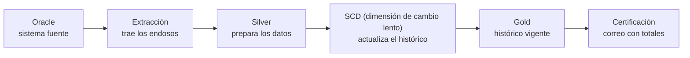
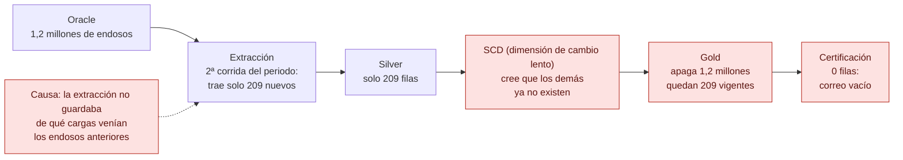
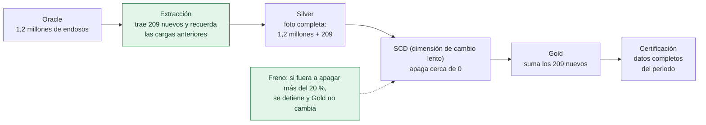
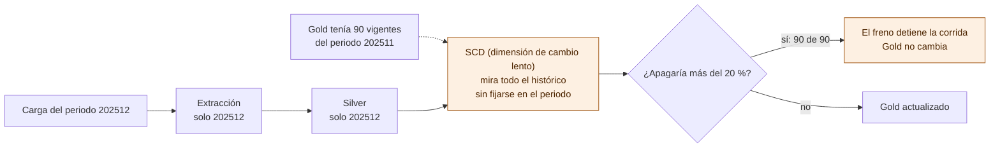
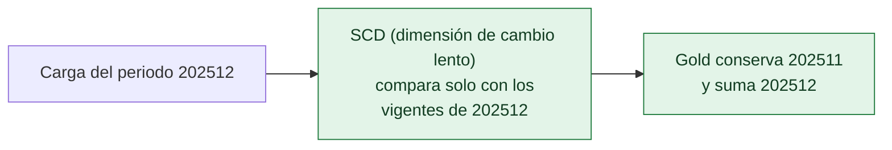

# Primas ARL: qué pasó, qué se corrigió y qué falta

**Para:** líderes de negocio, BA y líder técnico

**Fecha:** 13 de noviembre de 2026

**Detalle técnico:** [informe-tecnico.md](informe-tecnico.md)

## Convención de criticidad

| Nivel | Qué significa |
|---|---|
| **Crítico** | Puede borrar o alterar cifras ya cargadas o certificadas, sin aviso. |
| **Alto** | Puede dejar cifras incorrectas, duplicadas o de otro periodo sin que nadie lo note, o impide controlar la calidad del código. |
| **Medio** | Afecta la trazabilidad, el costo o la operación, pero no cambia las cifras de forma directa. |
| **Bajo** | Mejora de mantenimiento o limpieza. |

## Resumen

1. En producción, la certificación de Primas ARL del periodo 202606 salió vacía. Una segunda corrida del mismo periodo dejó vigentes solo 209 de 1,2 millones de endosos.
2. La causa ya está corregida: la extracción ahora recuerda las cargas anteriores. Además, un freno detiene el proceso si fuera a apagar más del 20 % del histórico.
3. Queda abierto el problema de fondo: al cargar un periodo nuevo, el proceso apaga los periodos anteriores. El freno lo está deteniendo, pero hace falta corregirlo.
4. Esa corrección necesita 4 respuestas de BA (sección 6).
5. En total se encontraron 33 hallazgos: 2 críticos, 7 altos, 12 medios, 6 bajos y 6 de otros componentes asignados a su responsable.
6. Todo se comprobó sobre el código y con una simulación del flujo completo, que reprodujo el incidente y confirmó que la corrección funciona.
7. Plan: todo el desarrollo de código se entrega a QA en 6 días hábiles, el martes 24 de noviembre, con tres líneas de trabajo en paralelo y si BA responde a más tardar el jueves 19 (sección 7).

## Índice

- [1. Cómo funciona el flujo de Primas ARL](#n1)
- [2. Qué pasó: el incidente de 202606](#n2)
- [3. Qué se corrigió](#n3)
- [4. Qué sigue abierto](#n4)
- [5. Hallazgos en números](#n5)
  - [5.1 Proceso de histórico: SCD (dimensión de cambio lento)](#n5-1)
  - [5.2 Proceso de extracción](#n5-2)
  - [5.3 Calidad del código](#n5-3)
  - [5.4 Otros componentes](#n5-4)
- [6. Qué se necesita de negocio](#n6)
- [7. Plan de entrega a QA: 6 días hábiles](#n7)
- [8. Cómo se comprobó](#n8)

## 1. Cómo funciona el flujo de Primas ARL

| Etapa | Qué hace, en palabras simples |
|---|---|
| Extracción | Trae de Oracle los endosos del periodo. Si el periodo ya se había cargado, trae solo lo nuevo para no repetir trabajo. |
| Silver | Junta los endosos con afiliaciones, terceros y sucursales, y deja una tabla lista para usar. |
| SCD (dimensión de cambio lento) | Compara lo que llega con el histórico: agrega lo nuevo, guarda una versión nueva de lo que cambió y apaga lo que ya no viene. |
| Gold | Es el histórico. Cada endoso tiene una versión vigente y sus versiones anteriores. |
| Certificación | Suma los endosos vigentes del periodo y envía el correo para certificar. |

## 2. Qué pasó: el incidente de 202606

La segunda corrida del periodo trajo solo los 209 endosos nuevos. El proceso de histórico tomó esos 209 como si fueran todos los que existen, y apagó el resto. Por eso el correo de certificación salió sin datos.

## 3. Qué se corrigió

- **Corrección de la causa:** la extracción ya recuerda las cargas anteriores, así que el histórico recibe la foto completa. Está en el repo y se comprobó en la simulación del flujo.
- **Red de seguridad:** el freno detiene el proceso antes de escribir si fuera a apagar más del 20 % del histórico. En QA ya actuó dos veces, y en las dos el histórico quedó intacto.

## 4. Qué sigue abierto

Ejemplo de Auxilios Funerarios en QA, el 12 de noviembre. En Primas ARL pasó lo mismo con 2.099 de 2.099 registros.

No hay un error en los datos. El proceso de histórico no sabe qué periodo se está cargando y trata los periodos anteriores como si hubieran desaparecido. El freno evita el daño, pero mientras no se corrija, cada carga de un periodo nuevo se va a detener.

**Corrección propuesta:**

Para hacerla, negocio tiene que confirmar cómo se define el periodo (sección 6).

## 5. Hallazgos en números

| Grupo | Total | Crítico | Alto | Medio | Bajo |
|---|---|---|---|---|---|
| SCD (dimensión de cambio lento): parte del fix | 1 | 1 | 0 | 0 | 0 |
| SCD (dimensión de cambio lento): adicionales | 9 | 1 | 3 | 3 | 2 |
| Extracción: adicionales | 10 | 0 | 2 | 5 | 3 |
| Calidad del código | 7 | 0 | 2 | 4 | 1 |
| **Subtotal con criticidad** | **27** | **2** | **7** | **12** | **6** |
| Otros componentes, con su responsable | 6 | | | | |
| **Total** | **33** | | | | |

La corrección del incidente en la extracción no está en el conteo porque ya está aplicada.

### 5.1 Proceso de histórico: SCD (dimensión de cambio lento)

Archivo `scd.py`. Hay **1 ítem a corregir como parte del fix** y **9 problemas adicionales**. De los 10, **2 son críticos, 3 altos, 3 medios y 2 bajos**.

| ID | Criticidad | Tipo | Qué pasa |
|---|---|---|---|
| SCD-02 | Crítico | Fix | Al cargar un periodo nuevo, se apagan los periodos anteriores. |
| SCD-01 | Crítico | Adicional | Si el histórico no se puede leer por un error momentáneo, se reemplaza por la carga nueva y se pierde la historia. |
| SCD-03 | Alto | Adicional | Un registro repetido en la entrada queda dos veces vigente, así que las cifras se duplican. |
| SCD-04 | Alto | Adicional | Los registros con un dato de identificación vacío se cierran y se vuelven a crear en cada corrida, y el histórico crece sin control. |
| SCD-05 | Alto | Adicional | No se valida que los totales cuadren antes de guardar. |
| SCD-06 | Medio | Adicional | Si el guardado falla a mitad, el histórico puede quedar incompleto, sin forma de volver atrás. |
| SCD-07 | Medio | Adicional | Los conteos de control no quedan en los registros del sistema. |
| SCD-08 | Medio | Adicional | Cuando el freno actúa, no deja el detalle de qué iba a apagar. |
| SCD-09 | Bajo | Adicional | El proceso repite cálculos y cuesta más de lo necesario. |
| SCD-10 | Bajo | Adicional | Algunos cambios menores no se detectan y las columnas de alerta no generan aviso. |

### 5.2 Proceso de extracción

Archivo `extraccion_estandar_optimized.py`. La corrección del incidente **ya está aplicada**, y quedan **10 problemas adicionales**: **ninguno crítico, 2 altos, 5 medios y 3 bajos**.

| ID | Criticidad | Qué pasa |
|---|---|---|
| EXT-01 | Alto | Si una carga falla y la siguiente es de otro periodo, se mezclan datos de los dos periodos. Se comprobó en la simulación. |
| EXT-02 | Alto | Si un endoso cambia en Oracle después de cargado, una nueva corrida del mismo periodo no trae el valor nuevo. Se comprobó en la simulación. |
| EXT-03 | Medio | La zona Bronce guarda solo la última carga, así que la historia queda en una sola copia. |
| EXT-04 | Medio | Un registro puede quedar en dos cargas y leerse dos veces. En Primas ARL se oculta. |
| EXT-05 | Medio | El estado de cada corrida se guarda en un único archivo que la siguiente reemplaza, y no queda rastro por ejecución. |
| EXT-06 | Medio | Los conteos de control no quedan en los registros del sistema. |
| EXT-07 | Medio | El costo de cada corrida crece con el tiempo. |
| EXT-08 | Bajo | Se traen todas las columnas de Oracle, aunque no se usen. |
| EXT-09 | Bajo | Hay un límite de control que siempre se supera y solo genera avisos. |
| EXT-10 | Bajo | Queda código sin uso y la hora usada es la del servidor. |

### 5.3 Calidad del código

Aplica a los procesos de extracción, histórico, remediación, validación y Silver de ARL. Son **7 problemas**: **2 altos, 4 medios y 1 bajo**.

| ID | Criticidad | Qué pasa |
|---|---|---|
| COD-01 | Alto | Los procesos están escritos como scripts largos que corren de arriba abajo, así que no se pueden probar por partes. |
| COD-02 | Alto | No hay pruebas automáticas y la medición de cobertura está apagada. No cumple el estándar del banco. |
| COD-03 | Medio | Hay funciones copiadas en 5 procesos, y algunas copias ya son distintas entre sí. |
| COD-04 | Medio | Hay funciones demasiado largas, difíciles de revisar. |
| COD-05 | Medio | La información que se pasan los procesos entre sí no tiene un formato definido. |
| COD-06 | Medio | Si falta un parámetro en la configuración, el proceso asume un valor sin avisar. |
| COD-07 | Bajo | Los errores no tienen un código que permita clasificarlos en el monitoreo. |

### 5.4 Otros componentes

| ID | Qué pasa | Responsable |
|---|---|---|
| ARL-01 | El periodo se filtra distinto en QA (solo el periodo) y en producción (todo hasta el periodo), así que las pruebas de QA no reflejan producción. Es parte del problema de fondo. | BA y desarrollo |
| ARL-03 | La extracción define el periodo con una fecha y la certificación con otra. En producción, el 91 % del histórico no tenía fecha de proceso y nunca se certifica. Es parte del problema de fondo. | BA |
| ARL-02 | El tercero asociado a un endoso puede cambiar entre corridas sin un cambio real. Está por confirmar con datos. | Desarrollo |
| ARL-04 | El correo de certificación puede salir con totales vacíos. Ya está en la tarea de notificaciones. | Desarrollo |
| ARL-05 | Si el flujo falla, no avisa a nadie, no tiene tiempos máximos y dos corridas a la vez pueden pisarse. | DevOps y desarrollo |
| ARL-06 | Si la validación técnica encuentra hallazgos, el flujo sigue igual. | Líder técnico y BA |

## 6. Qué se necesita de negocio

Estas respuestas desbloquean la corrección del problema de fondo y del hallazgo EXT-02:

1. ¿Cada corrida de Primas ARL debe traer todo hasta el periodo o solo el periodo?
2. Al cargar un periodo nuevo, ¿los periodos anteriores deben seguir vigentes en el histórico?
3. ¿Qué define el periodo de un endoso: el campo de periodo o la fecha de proceso?
4. ¿Un endoso ya cargado puede cambiar en Oracle (valor, tercero, sucursal) dentro del mismo periodo?

Las respuestas se necesitan a más tardar el **jueves 19 de noviembre** para cumplir el plan de la sección 7.

## 7. Plan de entrega a QA: 6 días hábiles

**Todo el desarrollo de código se entrega en 6 días hábiles.** Inicio el martes 17 de noviembre (el lunes 16 es festivo). Entrega a QA el martes 24 de noviembre.

Para cumplirlo, el trabajo se reparte en **tres líneas en paralelo**, con una persona en cada una:

- **Línea A, proceso de histórico:** `scd.py`.
- **Línea B, extracción y remediación:** `extraccion_estandar_optimized.py` y `remediacion_estandar.py`.
- **Línea C, base común, calidad y otros repos:** módulo común, pruebas, Silver de ARL y certificación.

| Día | Fecha | Línea A: histórico | Línea B: extracción y remediación | Línea C: base común, calidad y otros repos |
|---|---|---|---|---|
| 1 | Mar 17 nov | SCD-01, SCD-03 y SCD-04: que el histórico no se pierda por un error de lectura y que no queden registros duplicados ni vacíos | EXT-01, EXT-04, EXT-06 y COD-06: que una reanudación no mezcle periodos, que un registro no se lea dos veces, conteos de control y fallar si falta un parámetro | COD-03, COD-05 y COD-07: módulo común (lectura y escritura en S3, contrato entre procesos y códigos de error). Se envían las preguntas a BA y los pedidos a DevOps |
| 2 | Mié 18 nov | SCD-05, SCD-06, SCD-07 y SCD-08: cuadre antes de guardar, guardado en dos pasos con verificación, conteos de control y detalle cuando actúa el freno | EXT-08, EXT-09 y EXT-10: columnas explícitas, límite de control y limpieza | COD-02: pruebas automáticas con los escenarios ya simulados y cobertura activada en Sonar |
| 3 | Jue 19 nov | SCD-09, SCD-10, COD-01 y COD-04 en `scd.py`: cálculo una sola vez y separación en funciones que se puedan probar | EXT-03 y EXT-07: guardar Bronce y Silver base por lote, más el script que migra los datos existentes | COD-01 y COD-04 en extracción, remediación y validación. Se reciben las respuestas de BA |
| 4 | Vie 20 nov | SCD-02: comparar por periodo, según la respuesta de BA | EXT-02 y EXT-05: traer cambios del origen según BA, y estado por ejecución | ARL-02 (Silver de ARL), ARL-04 (correo con totales vacíos) y ajuste de configuración de ARL-01 y ARL-03 |
| 5 | Lun 23 nov | Todas las líneas: prueba completa del flujo en local con todos los escenarios, cobertura de pruebas y prueba en DEV con Primas ARL y Auxilios Funerarios | | |
| 6 | Mar 24 nov | Todas las líneas: un paquete por repo para DevOps, con archivos, instrucciones, plan de reversa y lista de pruebas para QA | | |

Después de la entrega, los paquetes pasan a DevOps para el despliegue en QA.

**Repos que se entregan:**

| Repo | Qué cambia |
|---|---|
| `data-datalake-niif-rmd-ext-estandar-glue-job` | Histórico, extracción, remediación y validación, más el módulo común y las pruebas |
| `data-datalake-niif-primas-arl-glue-job` | Silver de ARL (ARL-02) |
| Certificación y notificación | Correo con totales vacíos (ARL-04) |
| `cfg-datalake-niif-config-s3` | Configuración de periodo y de la consulta de resumen (ARL-01 y ARL-04) |

## 8. Cómo se comprobó

- Se leyó el código de cada etapa y la definición del flujo.
- Se ejecutaron los procesos reales, encadenados como en producción, con datos de prueba y los sistemas externos simulados. La simulación reprodujo el incidente, confirmó que la corrección funciona y confirmó los hallazgos marcados como comprobados.
- Se revisó la evidencia de QA del 12 de noviembre.
