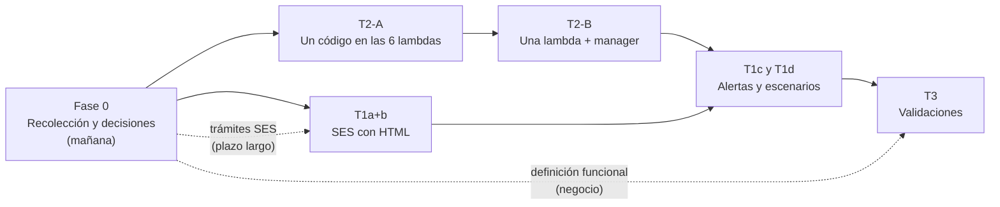

# Roadmap de cambios: tareas consolidadas y orden de trabajo

**Para qué:** juntar en un solo lugar las tareas de las dos fuentes, validar el orden propuesto (primero unificar las lambdas de configuración y después pasar de SNS a SES) y dejar claro qué cambia en cada paso, qué falta y cómo conseguirlo.

**Base:** el código y la configuración desplegados en DEV (cuenta 533267035849), extraídos el 2026-11-03. Para entender el flujo, leer primero `Docs\05-arquitectura\flujo-integral-niif17.md`; los problemas detectados están en `Docs\06-brechas\revision-pre-produccion.md` (IDs `PP-xx`). Lo marcado como **propuesta** se valida con el equipo antes de ejecutarlo.

---

## 1. Las tareas, de las dos fuentes

| Fuente | Qué dice |
|---|---|
| `Tareas\TareasAsignadas.txt` | 1. Notificaciones: (a) SNS a SES, (b) correo en HTML, (c) aviso a soporte cuando un proceso falla, (d) escenarios adicionales. 2. Un solo modelo de programación en las lambdas del gestor de configuración. 3. Validaciones de consistencia en reserva matemática (en definición funcional). |
| `Docs\07-entregables\image-1793750131056.png` | "Consolidar las lambdas configuradoras en 1 sola, la general estandarizada": las 6 `niif-dev-configuration-<malla>` (primas rentas, primas endosos, primas ARL, auxilios funerarios, reserva matemática RVI y ARP), más `niif-dev-manager-configuration`. |

La imagen **concreta la tarea 2 del txt**: dice cuál es el modelo único (una lambda general) y cuáles son las lambdas. No es una tarea distinta.

### Lista consolidada

| ID | Tarea | Componente que cambia | Detalle |
|---|---|---|---|
| **T2** | Una lambda general para los 6 configuradores, y el manager ajustado a ella | 6 lambdas `configuration-<malla>`, `manager-configuration`, sus roles y los *schedules* | Sección 4 |
| **T1a** | Enviar el correo de certificación por SES en vez de SNS | Job de Glue `niif-dev-notification-certification` y su rol | Sección 5 |
| **T1b** | Correo en HTML | El mismo job, más las plantillas de `Backend\htmlNew\` | Sección 5 |
| **T1c** | Aviso a soporte cuando falla cualquier parte del proceso | `PipelineObserver`, reglas de EventBridge, alarmas de lambdas | Sección 6 |
| **T1d** | Escenarios adicionales de notificación | Varios (lista en `Docs\05-arquitectura\tareas-sobre-el-flujo.md`) | Sección 6 |
| **T3** | Validaciones de consistencia de reserva matemática | Job `niif-dev-val-tecnica` y una etapa nueva antes de certificar | Sección 6 |

---

## 2. Validación del roadmap propuesto

**Propuesto:** 1) unificar las lambdas de configuración; 2) pasar de SNS a SES.

**Veredicto: el orden es correcto, con cinco ajustes.**

| # | Ajuste | Por qué |
|---|---|---|
| 1 | **Agregar una fase 0 de recolección (mañana)** antes de tocar código | Solo una de las 6 configuradoras tiene su código real (las demás son copias de la versión anterior) y **no tenemos el código del manager**. Además el manager hoy **no envía la malla** en el evento: cada lambda la conoce por su variable `MALLA_PK`. Con una sola lambda, el manager también tiene que cambiar. |
| 2 | **Hacer la T2 en dos pasos** | Paso A: **un solo código** desplegado en las 6 lambdas existentes, sin cambiar nombres, variables, *schedules* ni el manager. Paso B: **una sola lambda** y el manager enviando la malla. El paso A da casi todo el beneficio (un código, pruebas, un arreglo vale para todas) con mucho menos riesgo, y se puede pasar malla por malla. |
| 3 | **SNS a SES no depende de la T2: puede ir en paralelo** | Cambia otro componente (el job de notificación), otro rol y otra configuración. Lo que sí tiene plazo largo son los **trámites de SES**: verificar el dominio o el remitente (registros DNS del banco), salir del *sandbox* (caso a AWS) y el visto bueno de seguridad para enviar con el dominio de Seguros Alfa. **Hay que pedirlos mañana**, aunque el código se haga después. |
| 4 | **T1a y T1b son un solo cambio** | Se tocan las mismas líneas del mismo archivo (el armado y envío del mensaje), y SNS no admite HTML: pasar a SES sin HTML no tiene sentido, y HTML sin SES no es posible. |
| 5 | **Antes de probar la T2, dejar un solo programador** escuchando `prg-programaciones` | Hoy hay **dos triggers activos** sobre esa tabla (`manager-configuration` y `programador-configuraciones`, PP-03). Probar con los dos activos puede iniciar el proceso dos veces. Es una decisión del equipo. |

Dos condiciones transversales para que los cambios sean entregables (no solo funcionen):
- **Dónde vive la infraestructura.** Las lambdas de trabajo tienen la etiqueta `ManagedBy = Terraform-Terragrunt`: existe un repositorio de IaC que no conocemos. Cambiar a mano lo que maneja Terraform genera *drift*. Hay que ubicar ese repositorio (pregunta para mañana).
- **Repositorio de código y pruebas** (PP-02). El spike de la lambda general ya tiene 37 pruebas; falta un repositorio con pipeline según el estándar de versionamiento.

---

## 3. Roadmap

| Fase | Objetivo | Entregable | Terminado cuando | Depende de |
|---|---|---|---|---|
| **0. Recolección y decisiones** | Tener el código y la configuración reales | Zip de `recolectar-faltantes.sh`; respuestas a las preguntas de la sección 7; trámites de SES pedidos | El código de las 7 lambdas de la imagen y los JSON de configuración están en el repositorio local | Acceso a CloudShell |
| **T2-A. Un código en las 6 lambdas** | Eliminar las 6 copias sin cambiar nada alrededor | Lambda general (desde el spike) con pruebas, desplegada en las 6 funciones actuales, una malla a la vez | Las 6 funciones corren el mismo artefacto y generan los mismos 4 JSON que antes, malla por malla | Fase 0 y un solo programador |
| **T2-B. Una lambda y el manager** | Una sola función y un solo destino | Manager que envía `malla` en el evento y apunta a la lambda general; retiro de las 6 funciones | Los *schedules* apuntan a una función y la ejecución de cada malla es igual a la de T2-A | T2-A y el código del manager |
| **T1a+b. SES con HTML** | Correo en HTML con seguimiento de entrega | Job de notificación con canal configurable (SNS o SES), plantillas y conjunto de configuración de SES | Los correos de los 4 casos llegan en HTML, con el mismo contenido y enlaces, y los rebotes quedan registrados | Fase 0 y trámites de SES |
| **T1c y T1d** | Que soporte se entere de cualquier fallo | Alertas de jobs, lambdas, streams y SES; escenarios priorizados | Cada fallo del flujo genera un aviso con su `ejecucion_id` | T2 (logs comunes) y T1a+b |
| **T3** | No certificar datos inconsistentes | Reglas técnicas y de negocio con bloqueo configurable | Una regla bloqueante detiene el flujo y aparece en el correo | Definición funcional |

---

## 4. T2: qué cambia exactamente

### Lo que hay hoy
- 6 funciones con el **mismo código** y su propio rol (`niif-dev-conf-<malla>-role`). Difieren solo en `MALLA_PK`, `PRG_PK` y `STATE_MACHINE_ARN`.
- El manager (`scheduler_configurators.lambda_handler`, rol `niif-dev-programador-config-role`) lee `prg-programaciones`, crea un *schedule* por malla y elige el destino con `CONFIGURADORES_JSON`. El evento que envía es `{publicar, ejecutar, periodoNegocio, modoEjecucion, origen}`: **sin malla**.
- El spike (`Backend\Lamnbdas\inventario-aws\spike-primas-rentas\`) ya admite la malla en el evento (`malla`) o por variable, y tiene 37 pruebas. **Se basó en la versión anterior**: le faltan `_evento_desde_prg` y `_resolver_where_periodo`, que sí están en el código real de auxilios (`conf_auxilios.py`) y se pueden portar ya.

### T2-A: un código en las 6 funciones (propuesta)
1. Portar al spike las dos funciones que faltan, desde `conf_auxilios.py`, y agregar al catálogo de mallas las 5 restantes.
2. Comparar el código real de las 5 configuradoras (fase 0) con auxilios para confirmar que no hay otras diferencias.
3. **Prueba de equivalencia** por malla: con el mismo periodo, los 4 JSON que genera la lambda general deben ser iguales a los que publica hoy la lambda actual (se comparan contra los descargados en la fase 0).
4. Desplegar el artefacto en **una** función (Primas Rentas), con versión y alias para volver atrás, y ejecutar en modo validación (`publicar=false`).
5. Repetir con las otras 5.

**No cambia:** nombres, variables, roles, *schedules*, manager, Step Functions. **Vuelta atrás:** el alias apunta a la versión anterior.

### T2-B: una sola función (propuesta)
1. El manager agrega `"malla": "<MALLA>"` al evento y su mapa `CONFIGURADORES_JSON` apunta a la lambda general (necesita su código, fase 0).
2. Un rol único para la lambda general con permisos solo sobre las 6 máquinas y las rutas de las 6 mallas.
3. Volver a sincronizar los *schedules* (el manager lo hace cuando `scheduleEstado = PENDIENTE`).
4. Retirar las 6 funciones y, con el equipo, la generación anterior (`configurador-<malla>` y `programador-configuraciones`).

**Riesgo principal:** que la sincronización de *schedules* deje alguno apuntando a la función vieja. Se verifica con la lista de *schedules* (sección `scheduler` del script).

---

## 5. T1a + T1b: qué cambia exactamente

### Lo que hay hoy
- **Un solo punto de envío:** el job `niif-dev-notification-certification` hace `sns.publish` por destinatario (línea 605) con un cuerpo de texto (línea 578), y antes reescribe el `FilterPolicy` de cada suscripción (líneas 78-156). Lo lanza el trigger del stream `PENDING`, cuyo código no tenemos.
- Destinatarios, asunto y variables vienen del JSON de cada caso en `niif-dev-assets` (`email.destinations`, `subject`, `stringVars`).
- Ya hubo una prueba con SES: la lambda `testNotifications` usa `ses.send_email` y convierte tablas a HTML. Puede haber identidades verificadas (lo dice la sección `ses` del script).
- Las plantillas HTML de producción están en `Backend\notificacion\email-template\`; las herramientas y la versión compatible, en `Backend\htmlNew\`.

### El cambio (propuesta)
1. **Configuración, no código, para el canal:** agregar al JSON global (`configs/certification/json_global_notif_cert.json`) el canal (`SNS` o `SES`), el remitente y el conjunto de configuración de SES. Así **no hay que tocar el trigger**, cuyo código no tenemos.
2. **En el job:** si el canal es SES, rellenar la plantilla HTML del caso con lo que el job ya calcula (resumen, totales, archivos, enlaces y avisos de regeneración o sin datos) y enviar con `SendEmail` (HTML y texto) a cada destinatario. Guardar el `MessageId` de SES donde hoy se guarda el de SNS.
3. **Rol `niif-dev-jobs-notification-certification`:** permiso de envío en SES solo para la identidad y el conjunto de configuración. Con SES ya no necesita modificar suscripciones de SNS.
4. **Conjunto de configuración de SES** con eventos de entrega, rebote y queja hacia un destino que alimente la T1d.
5. **Plantilla por caso:** hay 4 correos (`auxilioFunerario`, `primasArl`, `primasRentasEndosos` y `reservaMatematicaRviArp`) y 5 plantillas (`auxilio_funerario_cert`, `primas_arl_cert`, `reservas_matematicas_cert`, `rentas_vitalicias_cert` y `previsional`). Las tres primeras coinciden por nombre; falta confirmar cuál corresponde a `primasRentasEndosos` y si `previsional` aplica a alguno de los 6.

**No cambia:** la certificación, los enlaces cortos, la API de certificar y el transporte. **Vuelta atrás:** cambiar el canal a `SNS` en el JSON global.

### Trámites que hay que pedir ya (plazo largo)
| Trámite | Con quién | Para qué |
|---|---|---|
| Verificar el dominio o la dirección remitente en SES (registros DKIM en el DNS) | TI del banco (DNS) | Poder enviar como Seguros Alfa |
| Salir del *sandbox* de SES en la cuenta | Caso a AWS | Enviar a cualquier destinatario, no solo a los verificados |
| Visto bueno de seguridad para enviar desde AWS con el dominio corporativo (SPF y DMARC) | Seguridad de la información | Que el correo no quede como suplantación |

Mientras tanto, en DEV se puede probar en *sandbox* verificando las direcciones del equipo.

---

## 6. Lo que sigue (resumen)

- **T1c y T1d:** extender `PipelineObserver` a los jobs `niif-dev-*` que fallen, alarmas y colas de fallos en las lambdas de la cadena, y avisos para los escenarios priorizados (validación con hallazgos, aprobador sin respuesta, rebote, falla del transporte). Detalle en `Docs\05-arquitectura\tareas-sobre-el-flujo.md`.
- **T3:** ampliar las reglas del job de validación (ya se configuran por JSON) y agregar una validación sobre el resultado, antes de certificar, con bloqueo configurable. Espera la definición funcional; las reglas técnicas se pueden adelantar.

---

## 7. Qué falta y cómo se obtiene

### Con el script (mañana, en CloudShell)
`Backend\cloudshell-inventario\recolectar-faltantes.sh`, solo lectura. Instrucciones en `Backend\cloudshell-inventario\LEEME-recolectar-faltantes.md`.

| Falta | Para | Sección del script |
|---|---|---|
| Código real de las 5 configuradoras y del manager | T2-A y T2-B | `lambdas` |
| Código del trigger de notificación, `copy-s3-cert`, `move-s3-certification` y `short-link-redirect` | Confirmar la cadena de T1 | `lambdas` |
| Cuál lambda envía a FIS (`EnvioSftpFis` o `datalake-dev-niif-send-via-sftp`, que es imagen de contenedor) y qué la dispara | Entender el final del flujo | `lambdas` y `buckets` |
| JSON de configuración de las 6 mallas y de certificación (destinatarios, consultas, grupos compuestos) | T2 (prueba de equivalencia) y T1 (plantillas) | `s3` |
| Si la cuenta está en *sandbox* de SES y qué identidades hay | T1a | `ses` |
| Registros de `cnf-mallas` y `prg-programaciones` | T2 | `dynamo` |
| *Schedules* actuales y a qué función apuntan | T2-B | `scheduler` |
| Permisos de los roles | T2 (rol único) y T1a (permiso de SES) | `iam` |
| Tiempos, DPU-horas y fallas de los últimos 30 días | Línea base antes de cambiar | `glue`, `sfn`, `metricas` |
| Bytes escaneados por Athena | Costos | `athena` |
| Si existe `niif-dev-transport` (las variables lo usan, el inventario no lo lista), cifrado, ciclo de vida y retención de logs | Transporte y costos | `buckets` y `logs` |

### Con personas (no se obtiene por script)
1. ¿Dónde está el repositorio de Terraform/Terragrunt de las lambdas? ¿También maneja jobs, Step Functions y crawlers?
2. ¿Cuál programador es el oficial? ¿Se puede deshabilitar el trigger de `programador-configuraciones`?
3. ¿Quién crea hoy las programaciones en `prg-programaciones`?
4. ¿Con qué dominio o dirección se enviará el correo, y quién gestiona el DNS y el visto bueno de seguridad?
5. ¿Qué plantilla corresponde a cada caso de uso?
6. ¿Quién define las reglas de negocio de reserva matemática y para cuándo?
